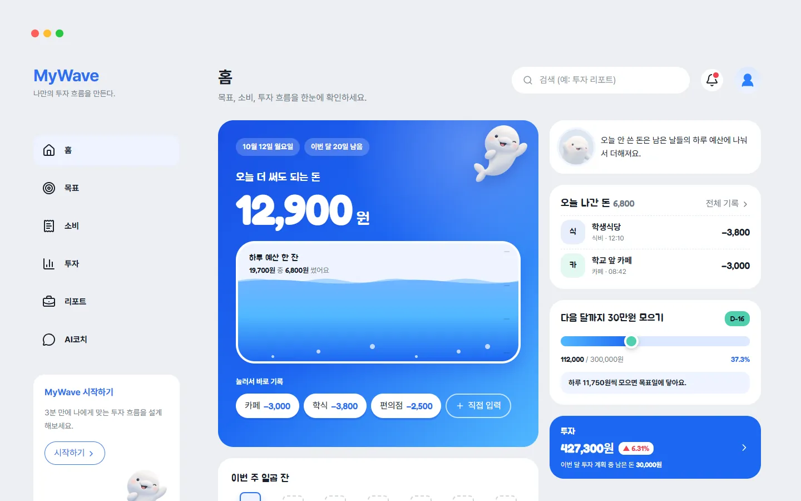
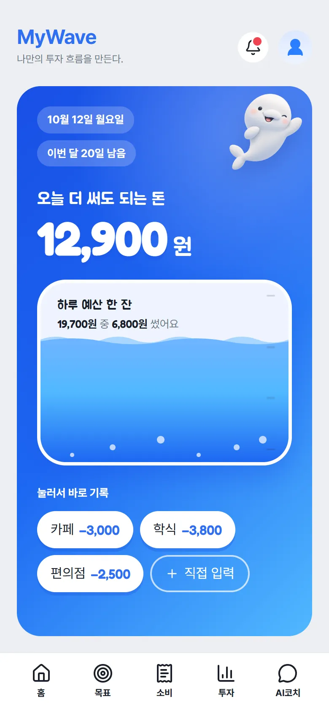
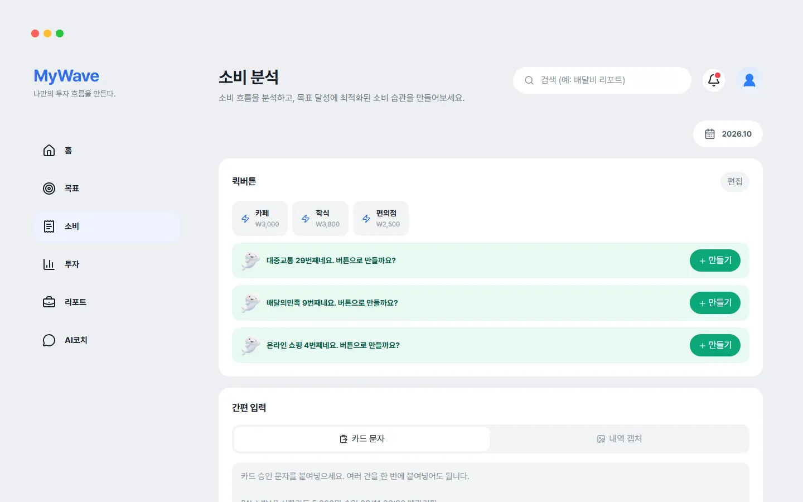
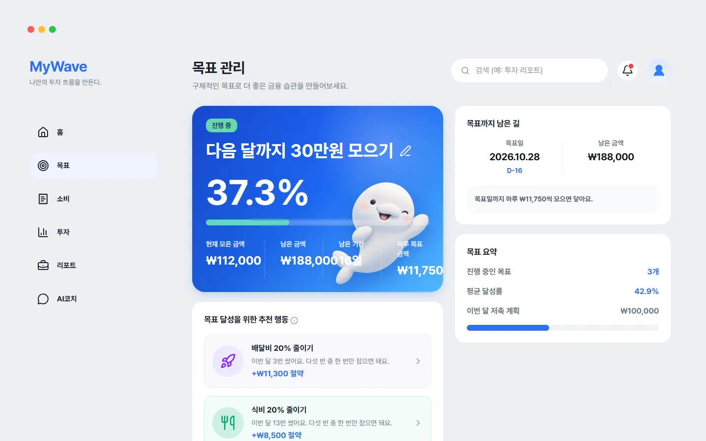
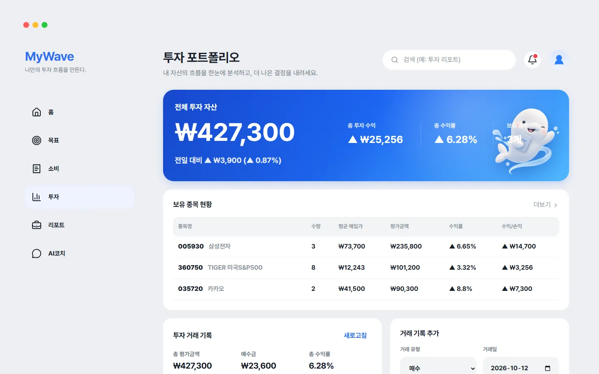
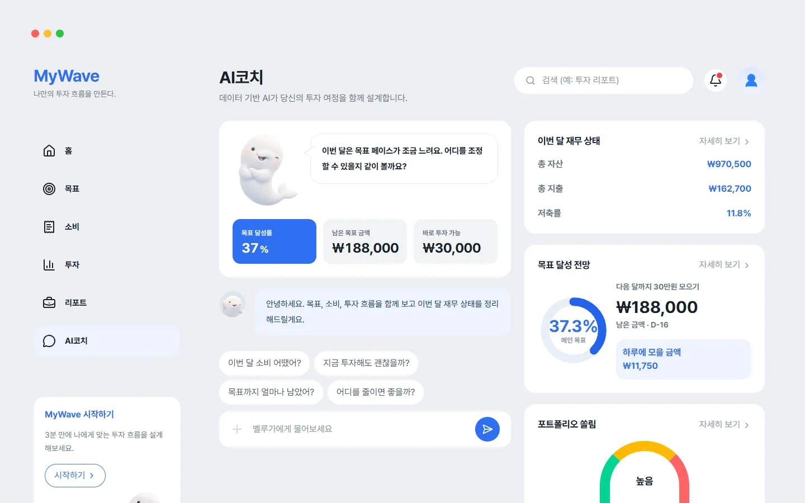

# MyStock-Desk

대학생이 매일 여는 개인 재무 웹앱입니다. 홈에는 숫자 하나만 크게 둡니다. **오늘 더 써도 되는 돈**입니다. 이번 달 남은 생활비를 남은 날수로 나눈 하루 예산에서 오늘 쓴 돈을 뺀 값이고, 소비를 하나 기록할 때마다 서버가 기록에서 다시 계산합니다.

그 아래에 저축 목표와 투자가 붙습니다. 투자는 증권사 계좌에 연결하지 않고 직접 입력한 매매 기록만으로 평균단가, 수익률, 자산 비중을 계산합니다. 화면 어디에도 예시 숫자를 채워 넣지 않습니다. 기록이 없으면 0이고, 서버에 닿지 못하면 그렇다고 알립니다.

| | |
|---|---|
|  |  |

이름이 셋입니다. 저장소 이름은 `MyStock-Desk`, 자바 패키지는 `com.stockflow`, 화면에 뜨는 이름은 MyWave입니다. 2026-06-21 커밋에서 UI를 MyWave로 갈아엎었고, 2026-10에 홈을 "오늘 더 써도 되는 돈" 중심으로 다시 설계하면서 남아 있던 옛 화면과 예시 숫자를 걷어냈습니다. 옛 이름들은 아직 아래층(패키지 이름, 쓰지 않는 백엔드 API)에 남아 있습니다.

| | |
|---|---|
| 기간 | 2026.05.25 ~ (첫 커밋 `주식 체계 프론트 디자인`). 2026.10 홈 재설계와 정리 |
| 인원 | 1명. 도메인 설계, Spring Boot API, React 화면 전부 |
| 배포 | 준비됨. docker compose 또는 Railway (아래 "배포하기" 참고. 로그인 화면에 데모 계정 버튼이 있습니다) |
| 소개 | `/story`에서 84초 분량의 인터랙티브 3D 소개 (직접 체험·자막·선택적 한국어 음성, 로그인 불필요) |
| 규모 | 백엔드 Java 243개 파일(테스트 11개 파일, 29개 별도), 엔드포인트 111개 중 MyWave가 쓰는 것 55개, 엔티티 24개 중 14개 |

## 문서

| 문서 | 내용 |
|---|---|
| [ERD](docs/ERD.md) | MyWave가 쓰는 테이블 14개와 관계, 아직 고치지 않은 스키마 문제 |
| [API 명세](docs/API.md) | 화면이 부르는 엔드포인트 56개, 요청과 응답 모양, 오류 코드 |
| [계산 규칙](docs/RULES.md) | 하루 예산, 투자 가능 금액, 목표 달성률 같은 숫자가 나오는 식과 실제 예시 |
| [시스템 구조](docs/ARCHITECTURE.md) | React, Spring Boot, DB, 외부 연동이 이어지는 모양, 요청 하나의 흐름, 폴더 |
| [화면 목록](docs/SCREENS.md) | 화면 19개의 캡처, 하는 일, 부르는 API |
| [배포 후 점검 기록](docs/TROUBLESHOOTING.md) | 공개한 날 AI와 함께 한 점검: 찾은 문제, 원인, 고친 방법, 확인한 방법 |

## 주요 코드

1. [`TodayService.today()`](backend/src/main/java/com/stockflow/dashboard/service/TodayService.java). 홈의 큰 숫자를 만드는 곳입니다. 하루 예산을 "어제까지 쓴 돈"으로 정하고 100원 단위로 내립니다. 저장하지 않고 요청마다 기록에서 다시 계산하고, 날짜는 주입받은 `Clock`에서 얻어서 [테스트](backend/src/test/java/com/stockflow/dashboard/service/TodayServiceTest.java)가 날짜를 고정해 확인합니다. 식은 [계산 규칙](docs/RULES.md#1-오늘-더-써도-되는-돈)에 있습니다.
2. [`Holding.buy()` / `sell()`](backend/src/main/java/com/stockflow/portfolio/entity/Holding.java#L39-L52). 이 서비스의 숫자를 전부 결정하는 14줄입니다. 매수는 직전 매입원가와 새 매입금액을 더해 나누고(이동평균), 매도는 수량만 줄이고 평균단가를 건드리지 않습니다. 이 차이가 "전량 매도 후 재매수"에서 수익률이 갈리는 지점입니다.
3. [`TransactionService.rebuildPortfolioFromTransactions()`](backend/src/main/java/com/stockflow/transaction/service/TransactionService.java#L306-L332). 거래 하나를 고치거나 지우면 보유 종목을 전부 지우고 거래 기록을 날짜순으로 다시 재생합니다. 증분 갱신을 쓰지 않은 이유는 아래 "설계 결정"에 있습니다.
4. [`ThemeAiExplanationService.explainWithOpenAi()`](backend/src/main/java/com/stockflow/theme/service/ThemeAiExplanationService.java#L46-L56). 이 저장소에서 언어 모델을 부르는 유일한 자리입니다. 지시문이 매수/매도 추천, 목표가, 상승 확률을 금지하고, 호출이 실패하면 규칙 기반 설명으로 내려갑니다.

## 주요 화면

| | |
|---|---|
|  |  |
| 이번 달 소비를 **지난달 같은 날짜까지**와 비교합니다. 12일까지 쓴 돈을 지난달 한 달 전체와 비교하면 매달 초에는 늘 "줄었다"가 되기 때문입니다. 기록은 직접 입력, 퀵버튼, 카드 문자 붙여넣기, 결제 캡처로 넣습니다. | 진행 중인 목표 중 목표일이 가장 가까운 것을 메인 목표로 두고, 하루에 얼마씩 모으면 되는지 보여 줍니다. 추천 행동은 이번 달 실제로 많이 쓴 카테고리 세 곳을 20% 줄였을 때 아끼는 돈입니다. |
|  |  |
| 이 서비스의 출발점입니다. 거래를 넣고 고치고 지우면 보유 종목의 수량과 평균단가가 `Holding.buy()`를 다시 거쳐 나옵니다. | 총자산, 소비, 목표, 리스크를 한 화면에 모았습니다. 다만 이 화면의 답변은 언어 모델이 아니라 규칙이 만듭니다. 바로 아래에 적었습니다. |

이 밖에 계좌 수동 등록과 월 예산, 기업 상세, 리포트, 알림, 검색이 있습니다. 화면 19개 전부는 [화면 목록](docs/SCREENS.md)에 있습니다.

## 설계 결정

### 기록이 없으면 0이다. 예시 숫자로 채우지 않는다

2026-10 재설계 전에는 화면 곳곳이 API가 비거나 실패하면 데모 사용자의 숫자를 대신 그렸습니다. 프론트의 `myWaveData.ts`에 금액이 통째로 들어 있었고, 백엔드도 소비, 목표, 예산, 알림을 조회하는 순간 비어 있으면 예시 기록을 **실제 계정에** 저장하고 있었습니다. 새로 가입한 사람이 첫 화면에서 "카페 지출 32% 증가" 알림을 받는 식이었습니다.

지금은 숫자가 전부 API에서만 옵니다. 예산을 정하지 않았으면 하루 예산은 0이고 화면은 "예산 정하기"를 띄웁니다. 대시보드 요청이 실패하면 0을 그리지 않고 "서버에서 숫자를 불러오지 못했어요" 띠를 띄웁니다. 예시 데이터는 데모 계정을 만들 때 `DataSeeder`가 한 번만 넣습니다. 기준은 하나입니다. 화면의 숫자를 보고 "이거 내 기록 맞아?"라고 물을 일이 없어야 합니다.

### 하루 예산은 저장하지 않고 매번 계산한다

하루 예산, 남은 생활비, 투자 가능 금액, 목표 달성률은 DB에 없습니다. 소비를 하나 지우면 같이 고쳐야 할 숫자가 넷이고, 저장해 두면 언젠가 하나를 빠뜨립니다. 그래서 요청마다 예산, 소비, 거래 기록에서 다시 셉니다. 홈의 퀵버튼을 누르면 화면이 숫자를 직접 빼지 않고 서버에 다시 묻습니다. 계산하는 곳이 한 곳뿐이라 홈과 소비 화면과 코치가 서로 다른 숫자를 말할 일이 없습니다. 투자의 보유 종목을 거래 기록에서 다시 만드는 것(아래)과 같은 생각입니다.

### "AI"라고 적힌 화면이 넷인데 모델을 부르는 곳은 하나

AI 코치, AI 리포트, AI 요약, 테마 설명 넷 중 실제로 OpenAI를 호출하는 것은 테마 설명 하나뿐이고, 그마저 기본 설정이 `stockflow.ai.provider: local`이라 꺼져 있습니다. 나머지 셋은 전부 자바 규칙입니다. [`PortfolioReportService`](backend/src/main/java/com/stockflow/ai/service/PortfolioReportService.java)는 보유 비중과 손익 개수를 세어 문장을 조립하고, [`FinancialCoachService.answer()`](backend/src/main/java/com/stockflow/coach/service/FinancialCoachService.java#L71-L91)는 질문에 "투자, 소비, 목표"가 들어 있는지만 보는 4갈래 분기입니다.

이렇게 둔 이유는 하나입니다. 이 화면에서 모델이 종목 이름을 말하는 순간 투자 권유가 됩니다. 그래서 모델을 부르는 유일한 자리에는 지시문으로 매수/매도, 목표가, 상승 확률을 금지했고([`ThemeAiExplanationService#L50-L56`](backend/src/main/java/com/stockflow/theme/service/ThemeAiExplanationService.java#L50-L56)), 규칙으로 쓰는 리포트에는 마지막 필드에 면책 문장을 데이터로 넣어서 화면이 지울 수 없게 했습니다([`PortfolioReportService#L56`](backend/src/main/java/com/stockflow/ai/service/PortfolioReportService.java#L56)).

대가는 코치 화면입니다. 실행해서 "지금 뭐 사야 돼? 종목 추천해줘"를 넣어 봤더니 돌아온 답은 거절이 아니라 기본 분기의 총자산 요약이었습니다. 종목을 말하지 않는다는 목적은 지켰지만, 거절하도록 만든 것이 아니라 말할 줄 몰라서 그런 것입니다. 4갈래 밖의 질문은 전부 같은 문장으로 떨어집니다. 규칙으로 안전을 확보한 대신 대화가 없습니다.

### 거래를 고치면 보유를 고치지 않고 처음부터 다시 계산

거래 기록은 사용자가 나중에 수정하고 삭제합니다. 보유 수량과 평균단가를 그때그때 더하고 빼면, 5월 매수 기록의 단가를 고치는 순간 그 뒤에 쌓인 모든 평균단가가 조용히 틀어집니다. 틀린 것을 알 방법도 없습니다.

그래서 등록, 수정, 삭제 세 경로 전부가 [`rebuildPortfolioFromTransactions()`](backend/src/main/java/com/stockflow/transaction/service/TransactionService.java#L306-L332)를 부릅니다. 보유 종목을 전부 지우고, 현금을 기준값으로 되돌리고, 거래를 날짜순으로 정렬해 처음부터 다시 재생합니다. 저장된 상태를 믿지 않고 매번 다시 만드는 방식입니다. 어떤 순서로 고쳐도 결과가 하나로 수렴하고, 각 거래의 실현손익도 재생 도중 다시 계산되어 저장됩니다([#L329](backend/src/main/java/com/stockflow/transaction/service/TransactionService.java#L329)).

대가는 거래 하나를 고칠 때 전체 거래 수 n에 비례해서 일한다는 것입니다. 지금은 시드가 종목 10개라 티가 나지 않고, 이 앱이 다루는 것은 한 사람의 매매 기록이라 n이 몇 천을 넘길 일이 잘 없다고 봤습니다. 넘긴다면 스냅샷을 찍고 그 뒤만 재생하는 것이 다음 순서입니다.

### 외부가 죽어도 화면이 사는 방식은 폴백이 아니라 갱신 건너뛰기

처음에는 Provider를 인터페이스로 두었으니 Yahoo가 죽으면 Demo로 자동 전환된다고 적어 두었습니다. 코드를 다시 읽으니 그렇지 않았습니다. [`YahooFinanceMarketDataProvider`](backend/src/main/java/com/stockflow/marketdata/provider/YahooFinanceMarketDataProvider.java#L19-L21)와 `DemoMarketDataProvider`는 `@ConditionalOnProperty`로 부팅 때 하나만 뜨고, 실행 중에는 바뀌지 않습니다.

실제로 화면을 지키는 것은 두 곳입니다. 종목 조회가 실패하면 예외를 삼키고 `null`을 돌려주고([#L70-L72](backend/src/main/java/com/stockflow/marketdata/provider/YahooFinanceMarketDataProvider.java#L70-L72)), 갱신 루프는 `null`인 종목을 건너뜁니다([`MarketDataRefreshService#L66-L70`](backend/src/main/java/com/stockflow/marketdata/service/MarketDataRefreshService.java#L66-L70)). 그래서 시세는 마지막으로 성공한 값 그대로 남고 화면은 비지 않습니다. 결과는 의도한 대로지만 메커니즘은 폴백이 아닙니다.

그리고 이 안전망이 뉴스에는 기본으로 꺼져 있습니다. `stockflow.news.seed-fallback.enabled`의 기본값이 `false`라서, RSS가 빈 결과를 주면 [`NewsService.getNews()`](backend/src/main/java/com/stockflow/news/service/NewsService.java#L28-L41)는 시드 뉴스로 채우지 않고 빈 배열을 냅니다. `GET /api/news`를 종목 없이 호출해 `[]`를 받아 확인했습니다. "외부가 실패하면 시드로 보정한다"는 옛 README의 문장은 시세에만 맞고 뉴스에는 틀렸습니다.

### 모든 외부 숫자가 출처를 달고 다님

한 화면에 실데이터와 데모 데이터가 섞이면 읽는 사람이 구분할 수 없습니다. 그래서 응답 DTO마다 출처 문자열을 실었습니다. 재무제표는 키가 없으면 `demo-public-disclosure`, OpenDART를 실제로 타면 `DART OpenAPI`로 바뀝니다. 공시와 뉴스에는 등급까지 붙습니다. SEC EDGAR는 `OFFICIAL`, `officialSource: true`([`SecDisclosureProvider#L97`](backend/src/main/java/com/stockflow/disclosure/provider/SecDisclosureProvider.java#L97)), Google News RSS는 `AGGREGATED`, `false`([`GoogleNewsRssProvider#L80-L81`](backend/src/main/java/com/stockflow/news/service/GoogleNewsRssProvider.java#L80-L81))입니다.

## 외부 연동 확인

배포본이 없어서 성능을 잰 수치는 없습니다. 대신 저장소를 그대로 받아 로컬에서 띄우고 외부 연동 네 곳이 지금도 살아 있는지만 확인했습니다.

| 외부 | 확인한 요청 | 응답 |
|---|---|---|
| Yahoo Finance chart | `POST /api/data/refresh` | 시드 종목 10개 시세 갱신 |
| Google News RSS | `GET /api/news?symbol=005930` | 삼성전자 관련 실제 기사 (출처 `매일경제 마켓 / Google News RSS`) |
| OpenDART | `GET /api/stocks/005930/financials` | 2026년 1분기 재무, `source: DART OpenAPI` (`DART_API_KEY` 있을 때) |
| SEC EDGAR | `GET /api/disclosures/sec` | NVDA FORM 4, `reliability: OFFICIAL` |

(2026-09-07, Windows 11, Java 17, `SPRING_PROFILES_ACTIVE=default`의 H2 인메모리, 시드 종목 10개, 각 1회. `DART_API_KEY`가 없으면 재무는 시드로 남고 `source`가 `demo-`로 표시됩니다. 위 화면 캡처 다섯 장도 같은 실행에서 1440×900으로 찍었습니다.)

## 남은 과제

2026-10 정리에서 옛 화면 11장, 3,800줄짜리 `MyWaveApp.tsx`, 홈의 하드코딩된 투자 의견과 목표가, 고정 보유 종목 표, 프론트의 조용한 폴백, 코치 답변의 `120883000.00원` 표기, 예산의 달이 DB에 직렬화된 바이트로 들어가던 문제를 해결했습니다. 남은 것을 다음에 손댈 순서대로 적었습니다.

- 백엔드에 MyWave가 쓰지 않는 엔드포인트가 56개, 테이블이 10개 남아 있습니다(모의 주문, 시장, 뉴스, 공시, 리서치 등). 프론트의 옛 화면은 지웠지만 백엔드는 아직입니다. 목록은 [API 명세](docs/API.md#mywave가-쓰지-않는-나머지) 맨 아래에 있습니다.
- 외부에서 온 시세를 범위 검증 없이 그대로 씁니다. 예전에 갱신 뒤 SK하이닉스 현재가가 평균단가의 정확히 10배로 들어와 수익률이 `900.00%`로 찍힌 적이 있습니다. 시세 갱신은 지금 기본으로 꺼져 있지만, 켜면 같은 일이 생길 수 있습니다.
- 테스트가 29개입니다. 하루 예산은 날짜를 고정한 단위 테스트로 잠갔지만, 평균단가(`Holding.buy()`/`sell()`)의 "전량 매도 후 재매수", 투자 가능 금액, 소비 비교 같은 나머지 계산에는 단위 테스트가 없습니다.
- 스키마 마이그레이션 도구(Flyway 등)가 없어서 운영 프로파일도 `ddl-auto: update`로 테이블을 만듭니다. 컬럼을 지우거나 이름을 바꾸는 변경은 Hibernate가 따라가지 못하므로, 도구를 들이고 `validate`로 바꿔야 합니다.
- 로그인 시도 제한이 서버 메모리에만 있어서 재시작하면 풀리고, 서버를 여러 대로 늘리면 공용 저장소(Redis 등)로 옮겨야 합니다.
- 거래 CSV 가져오기(`POST /api/transactions/import/csv`)는 백엔드에만 있고 UI에서 열 수 없습니다.

## 실행하기

<details>
<summary>백엔드 8080, 프론트 5173. 프로파일을 안 바꾸면 MySQL을 찾습니다</summary>

필요한 것: Java 17, Node 20 이상. DB 없이 띄우려면 프로파일을 바꿔야 합니다.

**백엔드.** `application.yml`의 기본 프로파일이 `mysql,local`이라 그냥 실행하면 `localhost:3306`을 찾습니다. H2 인메모리로 띄우려면:

```bash
cd backend
SPRING_PROFILES_ACTIVE=default ./gradlew bootRun     # Windows: .\gradlew.bat bootRun
```

내 컴퓨터의 MySQL로 붙일 때는 프로파일을 그대로 두고 `SPRING_DATASOURCE_URL`, `SPRING_DATASOURCE_USERNAME`, `SPRING_DATASOURCE_PASSWORD`를 환경변수로 줍니다. 비밀번호 기본값은 없습니다. 서버에 올릴 때는 아래 "배포하기"의 `prod` 프로파일을 씁니다.

부팅 때 `DataSeeder`가 종목 10개와 데모 회원 하나를 만들고, 그 회원에게 계좌, 이번 달과 지난달 예산, 지난달 1일부터 오늘까지의 소비, 목표 3개, 퀵버튼 3개, 거래 기록, 알림 3개를 채워 넣습니다. 로그인 화면의 "데모 계정으로 로그인" 버튼이 그 계정(`investor@stockflow.com` / `stockflow1234`)으로 들어갑니다. 새로 가입한 계정은 전부 비어 있는 상태로 시작합니다.

**프론트.**

```bash
cd frontend && npm install && npm run dev
```

`frontend/.env.example`이 그대로 기본값입니다. `VITE_API_BASE_URL`(개발 기본 `http://localhost:8080`), `VITE_ALLOW_MOCK_FALLBACK`. 백엔드 포트를 바꿨으면 프론트도 같이 바꿔야 합니다. CORS 허용 목록은 `STOCKFLOW_CORS_ALLOWED_ORIGINS`(쉼표로 구분, 개발 기본 `localhost:5173`, `127.0.0.1:5173`, `localhost:3000`)로 바꿀 수 있습니다([`CorsConfig`](backend/src/main/java/com/stockflow/global/config/CorsConfig.java)).

**선택 환경변수.** 없으면 그 기능만 시드나 규칙으로 내려가고 앱은 뜹니다.

| 변수 | 없을 때 |
|---|---|
| `DART_API_KEY` | 재무제표가 시드로 남고 `source`가 `demo-`로 표시됩니다 |
| `OPENAI_API_KEY` (+ `stockflow.ai.provider: openai`) | 테마 설명이 규칙 기반 로컬 설명으로 나갑니다 |
| `SEC_USER_AGENT` | SEC EDGAR에 예시 User-Agent로 요청합니다. 실제로 쓸 거면 연락처를 넣어야 합니다 |

Windows OneDrive 경로에서 Gradle이 `.class` 동기화 때문에 실패하는 것을 피하려고, 백엔드 빌드 산출물은 OS 임시 폴더의 `stockflow-backend-build`에 만들어집니다([`build.gradle#L11`](backend/build.gradle#L11)).

</details>

<details>
<summary>배포하기: docker compose 한 번, 비밀값은 .env 에만</summary>

서버 한 대에 MySQL 8.4, 백엔드(`prod` 프로파일), nginx(빌드한 화면 + `/api` 프록시)를 [`docker-compose.yml`](docker-compose.yml)로 띄웁니다. 브라우저는 화면과 API를 같은 주소에서 받으므로 CORS 설정이 필요 없고, 밖으로 열리는 포트는 nginx 하나입니다.

```bash
cp .env.example .env     # MYSQL_ROOT_PASSWORD, MYSQL_PASSWORD, STOCKFLOW_JWT_SECRET 을 채운다 (openssl rand -base64 48)
docker compose up -d --build
```

`prod` 프로파일([`application-prod.yml`](backend/src/main/resources/application-prod.yml))은 DB 접속 정보와 JWT 시크릿을 기본값 없이 환경변수로만 받아서, 하나라도 비면 부팅이 멈춥니다. 값이 있어도 개발용 시크릿이거나 32바이트보다 짧거나, H2 콘솔·`mock-member`·`show-sql`이 켜져 있으면 [`ProductionGuard`](backend/src/main/java/com/stockflow/global/config/ProductionGuard.java)가 이유를 적고 서버를 띄우지 않습니다. 개발 프로파일(`default`)에만 H2 콘솔과 개발용 시크릿이 있습니다.

HTTPS는 이 compose 앞에 Caddy 같은 리버스 프록시를 두고 `WEB_PORT`를 내부 포트로 돌려서 붙입니다. 아직 Flyway 같은 마이그레이션 도구가 없어 운영도 `ddl-auto: update`로 테이블을 만듭니다("남은 과제" 참고).

**Railway 에 올리기.** 서버를 직접 두지 않고 Railway 에 같은 Dockerfile 로 올릴 수 있습니다. 프로젝트 하나에 서비스 셋을 만듭니다. HTTPS 와 도메인은 Railway 가 붙여 줍니다.

| 서비스 | 만드는 법 | 변수 |
|---|---|---|
| `MySQL` | Database → MySQL | 없음 (Railway 가 만든 값을 아래에서 참조) |
| `backend` | GitHub 저장소, Settings → Root Directory `backend`, Healthcheck Path `/api/health` | `SPRING_DATASOURCE_URL` = `jdbc:mysql://${{MySQL.MYSQLHOST}}:${{MySQL.MYSQLPORT}}/${{MySQL.MYSQLDATABASE}}?serverTimezone=Asia/Seoul&characterEncoding=UTF-8&useSSL=false&allowPublicKeyRetrieval=true`, `SPRING_DATASOURCE_USERNAME` = `${{MySQL.MYSQLUSER}}`, `SPRING_DATASOURCE_PASSWORD` = `${{MySQL.MYSQLPASSWORD}}`, `STOCKFLOW_JWT_SECRET` = 새로 만든 32바이트 이상 값, `PORT` = `8080`, (선택) `GOOGLE_CLIENT_ID` |
| `frontend` | GitHub 저장소, Settings → Root Directory `frontend`, Healthcheck Path `/`, Networking 에서 공개 도메인 생성(포트 80) | `BACKEND_UPSTREAM` = `${{backend.RAILWAY_PRIVATE_DOMAIN}}:8080`, `PORT` = `80` |

**구글 로그인 켜기.** Google Cloud Console → API 및 서비스 → 사용자 인증 정보에서 OAuth 클라이언트 ID(웹 애플리케이션)를 만들고, 승인된 JavaScript 원본에 화면 주소(`https://mywave.day`, `https://www.mywave.day`, 개발용 `http://localhost:5173`)를 넣습니다. 리디렉션 URI는 쓰지 않습니다. 만든 ID를 백엔드의 `GOOGLE_CLIENT_ID`에 넣으면 로그인 화면에 버튼이 뜹니다. 프론트는 이 값을 빌드할 때가 아니라 뜰 때 서버에 묻기 때문에(`GET /api/auth/config`) 다시 빌드할 필요가 없습니다. 클라이언트 보안 비밀은 쓰지 않습니다. 화면이 받은 ID 토큰을 서버가 구글 공개키로 직접 검증합니다.

**구글 로그인만 받기.** 백엔드에 `STOCKFLOW_PASSWORD_LOGIN_ENABLED=false`를 넣으면 이메일·비밀번호 가입과 로그인을 서버가 거절하고, 로그인 화면에는 구글 버튼만 남습니다. 데모 버튼도 같이 꺼집니다. 가입할 때 이메일 주인인지 확인하지 않고 비밀번호를 되찾을 방법도 없어서, 실제 사용자를 받는 동안에는 꺼 둡니다. 변수를 지우거나 `true`로 바꾸면 원래대로 돌아옵니다.

서비스 이름은 `backend`, `frontend` 로 둡니다. 백엔드 내부 주소는 이름을 적지 않고 `${{backend.RAILWAY_PRIVATE_DOMAIN}}` 참조로 받습니다. 내부 주소는 서비스를 처음 만들 때 이름으로 정해지고 나중에 이름을 바꿔도 따라오지 않아서, 참조로 받아야 안 틀립니다. Root Directory 안에 Dockerfile 이 있으면 Railway 가 그걸로 빌드하므로 빌더 설정은 따로 없습니다. 헬스체크 경로와 실패 시 재시작은 서비스 Settings 에서 정합니다(예전의 `railway.json` 설정 파일은 Railway 가 더 이상 받지 않습니다). Railway 내부망은 IPv6 이고 백엔드 주소가 재배포마다 바뀌어서, nginx 는 `[::]` 도 듣고 `/api` 요청 때마다 백엔드 주소를 다시 찾습니다([`nginx.conf.template`](frontend/nginx.conf.template)). 백엔드 포트는 `prod` 프로파일이 `PORT` 를 따르고, `frontend` 의 공개 포트는 `PORT` 로 정합니다. 두 서비스 모두 외부에서 직접 열리는 건 `frontend` 하나이고 `/api` 는 그 뒤에서 넘어가므로 CORS 설정은 비워 둡니다. 로그인 시도 제한은 서버 메모리에 있으므로 Replicas 는 1 로 둡니다.

</details>

<details>
<summary>폴더</summary>

```text
backend/src/main/java/com/stockflow/   도메인 패키지 27개 (각 controller, dto, entity, repository, service)
  dashboard, expense, goal, asset      MyWave의 중심 (홈, 소비, 목표, 계좌와 예산)
  transaction, portfolio               투자 거래, 보유, 평균단가. 투자 숫자가 정해지는 곳
  notification, coach, search, company 알림, 코치, 검색, 기업 상세
  global, seed                         보안, Clock, 응답 형식, 숫자 표기, 시드 데이터
  market, news, trade, research ...    예전 모의투자 기능. 지금 화면은 쓰지 않음
frontend/src/mywave/                   MyWaveApp.tsx(라우트, 틀), TodayHome.tsx(홈), screens/(나머지 화면)
docs/                                  ERD, API 명세, 계산 규칙, 시스템 구조, 화면 목록
```

자세한 구조는 [시스템 구조](docs/ARCHITECTURE.md#폴더)에 있습니다.

</details>

## 3D 프로젝트 소개

프런트엔드의 `/story`는 벨루가가 MyWave 모바일 UI를 직접 조작하며 소개하는 6개 장면입니다. 실제 홈의 `SodaHero`, 공용 목표·자산 차트와 앱 원본 `BelugaArt`를 세로형 3D 스마트폰에 사용합니다. 데스크톱에서도 모바일 구성과 하단 탭을 보여줍니다. 벨루가는 버튼의 화면 위치로 이동해 기록·저축·자산 선택을 시연하고, 장면 사이에는 전체 화면 파도가 지나갑니다. 바다는 Three.js, 앱 UI는 조작 가능한 HTML과 CSS 3D로 구현했습니다. 백엔드 없이 볼 수 있고 모든 금액은 메모리에만 보관하는 소개용 예시입니다.

```bash
cd frontend
npm install
npm run story
```

브라우저에서 `http://127.0.0.1:5177/story`를 엽니다. 기존 개발 서버를 쓰면 그 주소 뒤에 `/story`를 붙이면 됩니다. `?scene=4`처럼 특정 장면을 바로 열 수도 있습니다.

- 아래 장면 버튼 또는 좌우 방향키: 장면 이동
- 재생 버튼 또는 Space: 재생·일시정지, 슬라이더: 재생 위치 이동
- 자동 진행 해제: 현재 장면 끝에서 정지, F: 전체화면
- 페이지를 열면 자동으로 시작합니다. 각 장면의 6.8초 지점에서 벨루가가 한 번 시연하고, 다음 메뉴를 가리킨 뒤 파도와 함께 장면을 넘깁니다. 마지막 장면 뒤에는 예시 데이터를 초기화하고 반복합니다.
- 입체 앱의 커피·점심 퀵버튼: 소비 기록 추가와 남은 금액·수위 변경. `직접 입력`은 예시 소비 입력창을 엽니다.
- 앱의 목표·투자 메뉴: 파도와 함께 해당 소개 장면으로 이동
- `5만원 저축하기` / `1만원 넣기`: 목표 금액과 달성률 변경
- 예시 A/B/C 버튼: 선택한 자산의 금액과 비중 표시
- 화면 어디든 빈 곳 클릭/탭: 물결이 퍼지며 벨루가가 해당 위치로 이동
- 바다 드래그: 360도 회전 및 높이 변경, 휠 또는 +/− 버튼: 확대·축소. 카메라를 직접 조작해도 자동 재생은 이어집니다.
- `바다만 보기`: 설명과 앱을 접고 공간 탐색. 이 모드의 벨루가도 원본 그림을 이용한 3D 공간의 스프라이트입니다. 잔·저금통 등 소품을 직접 누를 수 있습니다.
- `앱 시연 보기` 또는 `Esc`: 소개 UI 복원
- 직접 체험해도 영상은 계속됩니다. 결과 안내는 3초 뒤, 바다 탐색은 4초 뒤 자동으로 설명 화면에 돌아옵니다. 재생 버튼으로 명시적으로 일시정지한 경우에는 멈춘 상태를 유지합니다. 초기화로 모든 체험 값을 되돌릴 수 있습니다.
- 음성 설명은 기본으로 꺼져 있습니다. 켜면 브라우저의 한국어 음성을 사용하고, 지원하지 않거나 한국어 음성이 없으면 안내 문구와 자막을 제공합니다.
- 시스템의 동작 줄이기 설정을 존중하며, WebGL을 쓸 수 없으면 안내와 소개 글을 표시합니다.

소개 페이지 코드는 `frontend/src/story/`에 있고, 문구와 장면 순서는 `chapters.ts`, 시연 동작과 시점은 `tour.ts`, 모바일 UI 구성과 캐릭터 동선은 `AppTheatre.tsx`, UI 요소별 입체 분리·조립은 `useExplodedScreen.ts`에서 수정합니다. `WaveTransition.tsx`는 화면 뒤로 짧게 흐르는 물결을 표시합니다. 기본 설명은 84초이며 화면 전환·음성 설명 대기 시간은 별도입니다. 3D 배경 코드는 소개 화면에 들어갈 때 따로 로드됩니다.

재생 시간의 React 갱신은 초당 10회로 제한하고, 시연 패널은 동작 단계가 바뀔 때만 다시 렌더링합니다. 바다는 독립적인 연속 RAF 시계로 움직여 장면 전환 중에도 정지하거나 처음으로 튀지 않습니다. 스마트폰 프레임은 장면 사이에 유지하며, 캐릭터 위치는 단계·크기 변경 때만 측정하고 표정은 교차 페이드합니다. 소개 모드에서는 배경 그림자 패스를 생략하고 바다 메시·픽셀 비율을 줄여 렌더링 부담을 낮췄습니다.

소개 전용 `relief.css`는 실제 앱의 색과 타이포그래피를 유지하면서 카드·유리잔·버튼에 얕은 그림자를 더합니다. `ReliefChart.tsx`는 같은 예시 데이터로 옆면이 있는 목표 링과 자산 도넛을 그리며, 선택한 자산 조각은 위로 떠오릅니다. 벨루가가 누르는 버튼과 직접 누른 버튼 모두 눌림 깊이가 바뀝니다. 실제 앱 화면의 스타일에는 적용되지 않습니다.

배경은 깊은 MyWave 블루의 수면과 가는 빛의 곡선을 사용합니다. 소개 모드에서는 구름·동전·큰 기포·색종이를 숨겨 UI에 집중하며, 바다 탐색 모드에는 기존 소품이 남아 있습니다. `OceanResponse.tsx`와 `ocean.css`는 포인터를 따르는 빛, 터치 파문, 자동 시연에 맞춘 물방울을 담당합니다. 같은 동작이 Three.js 바다의 파문과 동전·기포에도 연결됩니다. 추가 효과는 React의 매 프레임 갱신 없이 transform/opacity로 움직이며, 시스템의 동작 줄이기 설정에서는 생략합니다.

화면 전환은 `surf.ts`의 2.52초 공유 시계를 사용합니다. 원본 벨루가가 안내하는 동안 폰의 화면 바탕·네 조각의 테두리·카메라 영역·상태 표시·하단 바까지 실제 HTML UI 요소들과 함께 분리됩니다. 빠르게 감기는 수평 궤도에서 폰 부품과 카드·물잔·차트 조각이 분리되고, 숫자와 설명은 원래 카드에 남아 읽을 수 있습니다. 카드별 요소들은 같은 회전 흐름을 따라가되 작은 시차와 간격을 유지합니다. 회전 중심과 반경은 폰 크기가 아니라 전체 뷰포트에서 계산합니다. 헤더와 플레이어를 제외한 화면 양쪽으로 UI 요소가 퍼지고, X/Z 평면의 수평 궤도를 따라 폰 뒤와 앞을 지나 마지막에 모입니다. 요소별 높이는 작은 차이로 유지하고, 상하 흔들림은 9~18px로 제한합니다. 뒤쪽에서는 작아지고 폰에 가려지며 앞쪽에서는 원근에 따라 커집니다. 원근과 각 요소의 크기를 반영해 화면 가장자리의 여백을 확보합니다. DOM 부모·자식의 이동과 확대를 보정하여 폰 바탕은 조금 작게, 핵심 카드는 더 크게 보여주고 버튼·차트는 독립적인 깊이로 앞뒤를 오갑니다. 1초에 다음 장면을 적용하고 같은 시계의 회전 방향·속도를 이어갑니다. 넓은 궤도를 유지하다가 몸체 부품이 160ms, UI가 170ms 동안 모입니다. 몸체는 6ms 간격, UI는 30ms 뒤부터 단계당 5ms와 요소별 3ms의 작은 시차로 합쳐져 전체 조립이 약 250ms 안에 끝납니다. 조립 중에도 추가 각도 이동을 이어가며 회전 궤도를 빠르게 좁힙니다. 완성 순간에는 140ms 동안 빛의 링과 1.8% 크기의 짧은 반동이 공유 시계에 맞춰 재생됩니다. 곡선 궤적은 전환 시작 때 97개 키프레임으로 계산하고 가속도까지 연속인 곡선으로 분리·착지합니다. 모바일에서는 분리 거리를 줄입니다. 위치와 스타일은 화면별 전환 시작 때 한 번만 읽고, Web Animations가 transform을 재생하며 공유 시계와의 오차·재생 상태가 바뀔 때 동기화합니다. 전환 도중 일시정지·재개해도 부품들의 타이밍이 유지되며 조립 완료 후에는 원래 UI 스타일로 돌아갑니다. 동작 줄이기 또는 멈춘 상태에서 장면을 직접 선택하면 즉시 이동합니다.

전환 중 카드·버튼·폰 바탕에는 네 방향의 CSS 3D 옆면과 뒷면이 붙습니다. 버튼은 7px, 카드는 16px, 폰 바탕은 22px 두께이며 밝은 윗면과 어두운 옆면으로 회전 방향이 드러납니다. 큰 카드도 좌우 회전과 앞뒤 기울기를 적용하고, 자식 요소는 부모의 회전 행렬을 역으로 보정해 독립적인 궤도를 유지합니다. 옆면은 전환 시작 때 생성하고 종료 시 제거하므로 조립 후 원본 UI의 배치와 스타일은 유지됩니다.

`useGuideDirector.ts`는 벨루가의 손짓·수영·도착을 같은 전환 시계에 연결합니다. 손짓이 시작된 뒤 180ms부터 UI가 풀리고, 벨루가는 수평 흐름을 먼저 타다가 조립 시작보다 먼저 폰 옆에 도착합니다. 기존 원화의 옆으로 헤엄치는 포즈와 가리키는 포즈를 사용하며, 크기·기울기·앞뒤 가림·얇은 물결 흔적으로 깊이를 표현합니다. 별도 3D 캐릭터 모델은 사용하지 않습니다. `playStoryAnimations.ts`는 벨루가와 UI 애니메이션을 함께 정지·재개하며 비활성 탭에서는 쉽니다. 설명 중에는 폰 전체가 데스크톱 6.5%, 모바일 3.5% 가까워지고, 터치 후 벨루가가 옆으로 물러나 결과를 보여줍니다. 전환 중에는 카메라 위치를 고정해 궤도가 흔들리지 않습니다.

`direction.css`는 소개 연출과 작은 재생 바를 담당합니다. 장면 이름 버튼을 누르면 여섯 장면과 자동 진행 설정이 펼쳐지고, 장면을 선택하면 닫힙니다. 일시정지·시간 탐색·음성·전체화면은 기본 바에 남습니다. 바다 시점 조작은 `바다만 보기` 모드에서 표시합니다. 동작 줄이기 설정에서는 카메라 확대와 전환 연출을 생략합니다.

전환 효과는 `useSurfPresentation.ts`에서 각 요소의 Web Animations로 재생합니다. 페이지 루트의 상속 CSS 변수를 매 프레임 바꾸지 않으며, 원본 UI의 3D 부모를 평면화하지 않도록 옆면·뒷면에만 투명도를 적용합니다. 분리 궤적은 부모 회전 행렬과 스타일 읽기를 재사용하고, 모든 키프레임 계산 후 DOM 변경과 애니메이션 등록을 모아서 처리합니다. 전환 시계는 지연된 프레임의 실제 경과 시간을 반영해 재생 위치가 뒤로 보정되는 현상을 줄이고, 탭 복귀 시에는 기준 시간을 재설정합니다. 소개 중에는 보이지 않는 탐색용 3D 그룹을 씬에서 잠시 분리해 행렬 순회·소품 업데이트·숨겨진 라벨 텍스처 업로드를 건너뜁니다. 바다 탐색에 들어가면 그룹을 다시 연결합니다.

배경은 하나의 WebGL 렌더러를 사용합니다. 기포·구름은 인스턴싱하고 실시간 그림자는 생략합니다. 픽셀 비율은 최대 1이며 연속된 저속 렌더링 구간에서는 0.75로 줄입니다. `storyActivity.ts`는 BroadcastChannel로 소개 탭 하나만 재생하고, 다른 탭은 WebGL·타임라인·레이어 전환·CSS 애니메이션을 쉬게 합니다. 다시 포커스를 받은 탭은 이어서 재생합니다. 개발 확인용 `/story?perf=1`은 FPS·draw call·픽셀 비율을 표시합니다. FPS는 기기·브라우저·탭 스로틀링에 따라 달라집니다.

## 만든 사람

정재훈, 아주대학교. 다른 작업은 [포트폴리오](https://jaehun.co.kr)와 [GitHub](https://github.com/toadsam)에 있습니다.

이 서비스는 투자 기록 관리와 참고 정보 제공만 합니다. 실제 주문, 체결, 계좌 연동 기능은 없고, 화면의 어떤 문장도 투자 자문이 아닙니다.

코드와 화면은 포트폴리오 공개 목적이며, 별도 표기 전까지 무단 사용, 복제, 배포를 허용하지 않습니다.
