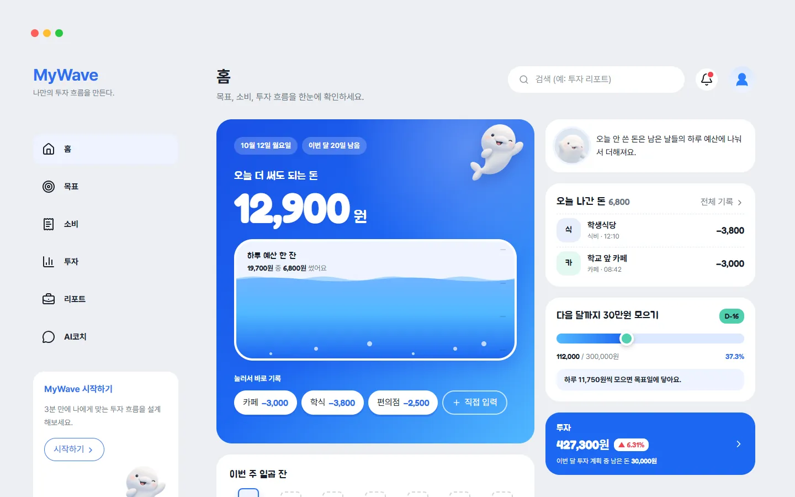
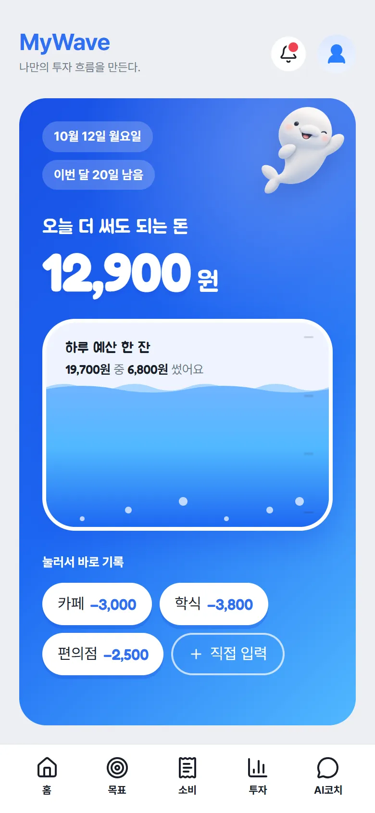
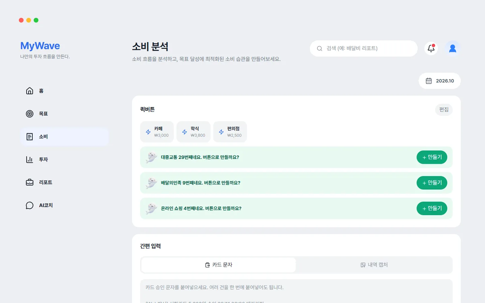
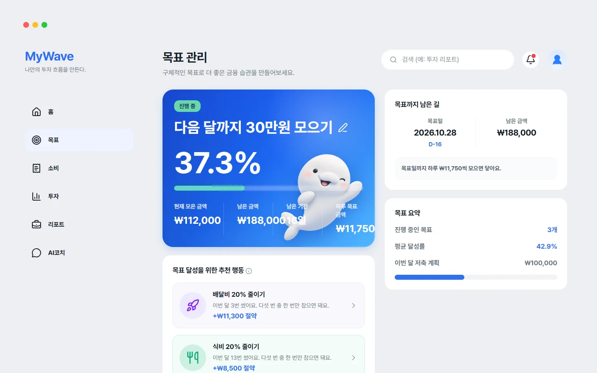
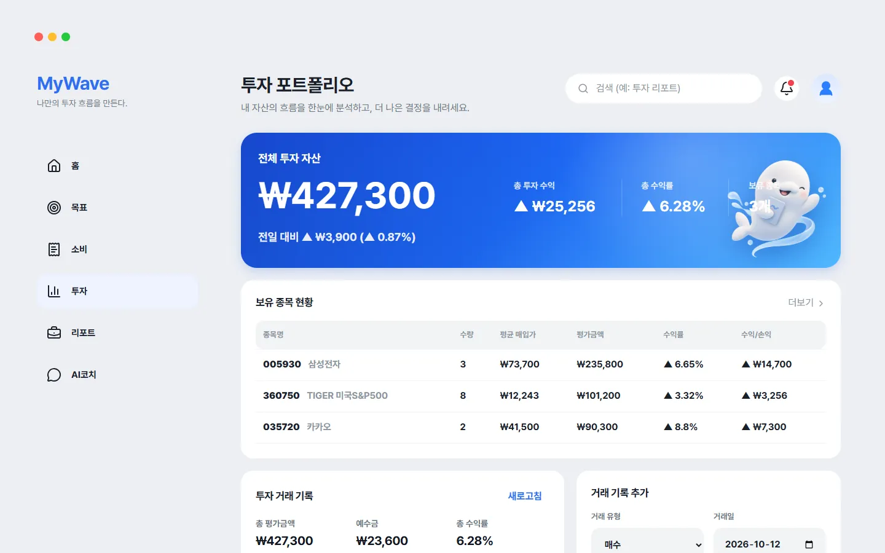
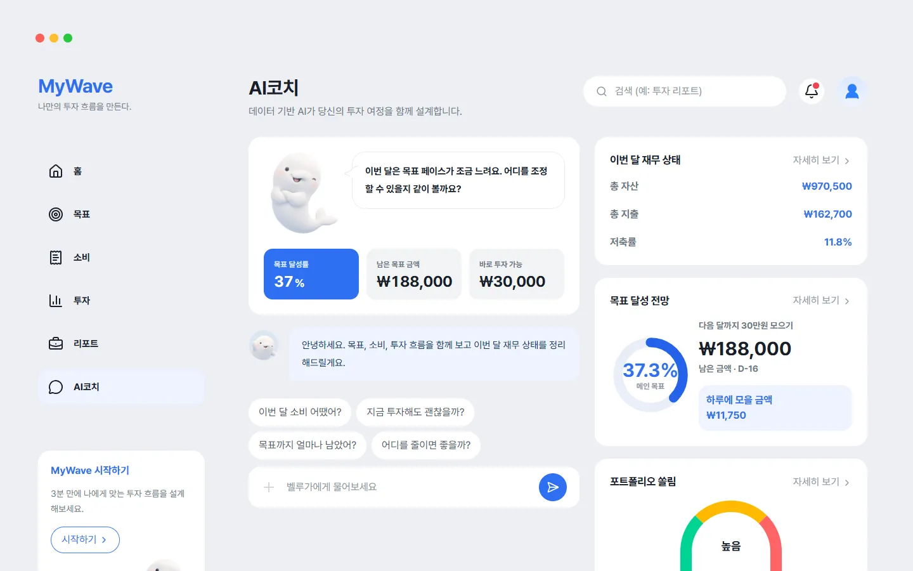

# MyStock-Desk

대학생이 매일 여는 개인 재무 웹앱입니다. 홈에는 숫자 하나만 크게 둡니다. **오늘 더 써도 되는 돈**입니다. 이번 달 남은 생활비를 남은 날수로 나눈 하루 예산에서 오늘 쓴 돈을 뺀 값이고, 소비를 하나 기록할 때마다 서버가 기록에서 다시 계산합니다.

그 아래에 저축 목표와 투자가 붙습니다. 투자는 증권사 계좌에 연결하지 않고 직접 입력한 매매 기록만으로 평균단가, 수익률, 자산 비중을 계산합니다. 화면 어디에도 예시 숫자를 채워 넣지 않습니다. 기록이 없으면 0이고, 서버에 닿지 못하면 그렇다고 알립니다.

| | |
|---|---|
|  |  |

이름이 셋입니다. 저장소 이름은 `MyStock-Desk`, 자바 패키지는 `com.stockflow`, 화면에 뜨는 이름은 MyWave입니다. 2026-06-21 커밋에서 UI를 MyWave로 갈아엎었고, 2026-10에 홈을 "오늘 더 써도 되는 돈" 중심으로 다시 설계하면서 남아 있던 옛 화면과 예시 숫자를 걷어냈습니다. 옛 이름들은 아직 아래층(패키지 이름, 쓰지 않는 백엔드 API)에 남아 있습니다.

| | |
|---|---|
| 기간 | 2026.05.25 ~ (첫 커밋 `주식 체계 프론트 디자인`). 2026.10 홈 재설계와 정리 |
| 인원 | 1명. 도메인 설계, Spring Boot API, React 화면 전부 |
| 배포 | 없음. 로컬에서만 동작합니다 (아래 "실행하기" 참고. 로그인 화면에 데모 계정 버튼이 있습니다) |
| 영상 | 없음 |
| 규모 | 백엔드 Java 239개 파일(테스트 10개 파일, 24개 별도), 엔드포인트 111개 중 MyWave가 쓰는 것 55개, 엔티티 24개 중 14개 |

## 문서

| 문서 | 내용 |
|---|---|
| [ERD](docs/ERD.md) | MyWave가 쓰는 테이블 14개와 관계, 아직 고치지 않은 스키마 문제 |
| [API 명세](docs/API.md) | 화면이 부르는 엔드포인트 55개, 요청과 응답 모양, 오류 코드 |
| [계산 규칙](docs/RULES.md) | 하루 예산, 투자 가능 금액, 목표 달성률 같은 숫자가 나오는 식과 실제 예시 |
| [시스템 구조](docs/ARCHITECTURE.md) | React, Spring Boot, DB, 외부 연동이 이어지는 모양, 요청 하나의 흐름, 폴더 |
| [화면 목록](docs/SCREENS.md) | 화면 19개의 캡처, 하는 일, 부르는 API |

## 주요 코드

1. [`TodayService.today()`](backend/src/main/java/com/stockflow/dashboard/service/TodayService.java). 홈의 큰 숫자를 만드는 곳입니다. 하루 예산을 "어제까지 쓴 돈"으로 정하고 100원 단위로 내립니다. 저장하지 않고 요청마다 기록에서 다시 계산하고, 날짜는 주입받은 `Clock`에서 얻어서 [테스트](backend/src/test/java/com/stockflow/dashboard/service/TodayServiceTest.java)가 날짜를 고정해 확인합니다. 식은 [계산 규칙](docs/RULES.md#1-오늘-더-써도-되는-돈)에 있습니다.
2. [`Holding.buy()` / `sell()`](backend/src/main/java/com/stockflow/portfolio/entity/Holding.java#L39-L52). 이 서비스의 숫자를 전부 결정하는 14줄입니다. 매수는 직전 매입원가와 새 매입금액을 더해 나누고(이동평균), 매도는 수량만 줄이고 평균단가를 건드리지 않습니다. 이 차이가 "전량 매도 후 재매수"에서 수익률이 갈리는 지점입니다.
3. [`TransactionService.rebuildPortfolioFromTransactions()`](backend/src/main/java/com/stockflow/transaction/service/TransactionService.java#L306-L332). 거래 하나를 고치거나 지우면 보유 종목을 전부 지우고 거래 기록을 날짜순으로 다시 재생합니다. 증분 갱신을 쓰지 않은 이유는 아래 "설계 결정"에 있습니다.
4. [`ThemeAiExplanationService.explainWithOpenAi()`](backend/src/main/java/com/stockflow/theme/service/ThemeAiExplanationService.java#L46-L56). 이 저장소에서 언어 모델을 부르는 유일한 자리입니다. 지시문이 매수/매도 추천, 목표가, 상승 확률을 금지하고, 호출이 실패하면 규칙 기반 설명으로 내려갑니다.

## 주요 화면

| | |
|---|---|
|  |  |
| 이번 달 소비를 **지난달 같은 날짜까지**와 비교합니다. 12일까지 쓴 돈을 지난달 한 달 전체와 비교하면 매달 초에는 늘 "줄었다"가 되기 때문입니다. 기록은 직접 입력, 퀵버튼, 카드 문자 붙여넣기, 결제 캡처로 넣습니다. | 진행 중인 목표 중 목표일이 가장 가까운 것을 메인 목표로 두고, 하루에 얼마씩 모으면 되는지 보여 줍니다. 추천 행동은 이번 달 실제로 많이 쓴 카테고리 세 곳을 20% 줄였을 때 아끼는 돈입니다. |
|  |  |
| 이 서비스의 출발점입니다. 거래를 넣고 고치고 지우면 보유 종목의 수량과 평균단가가 `Holding.buy()`를 다시 거쳐 나옵니다. | 총자산, 소비, 목표, 리스크를 한 화면에 모았습니다. 다만 이 화면의 답변은 언어 모델이 아니라 규칙이 만듭니다. 바로 아래에 적었습니다. |

이 밖에 계좌 수동 등록과 월 예산, 기업 상세, 리포트, 알림, 검색이 있습니다. 화면 19개 전부는 [화면 목록](docs/SCREENS.md)에 있습니다.

## 설계 결정

### 기록이 없으면 0이다. 예시 숫자로 채우지 않는다

2026-10 재설계 전에는 화면 곳곳이 API가 비거나 실패하면 데모 사용자의 숫자를 대신 그렸습니다. 프론트의 `myWaveData.ts`에 금액이 통째로 들어 있었고, 백엔드도 소비, 목표, 예산, 알림을 조회하는 순간 비어 있으면 예시 기록을 **실제 계정에** 저장하고 있었습니다. 새로 가입한 사람이 첫 화면에서 "카페 지출 32% 증가" 알림을 받는 식이었습니다.

지금은 숫자가 전부 API에서만 옵니다. 예산을 정하지 않았으면 하루 예산은 0이고 화면은 "예산 정하기"를 띄웁니다. 대시보드 요청이 실패하면 0을 그리지 않고 "서버에서 숫자를 불러오지 못했어요" 띠를 띄웁니다. 예시 데이터는 데모 계정을 만들 때 `DataSeeder`가 한 번만 넣습니다. 기준은 하나입니다. 화면의 숫자를 보고 "이거 내 기록 맞아?"라고 물을 일이 없어야 합니다.

### 하루 예산은 저장하지 않고 매번 계산한다

하루 예산, 남은 생활비, 투자 가능 금액, 목표 달성률은 DB에 없습니다. 소비를 하나 지우면 같이 고쳐야 할 숫자가 넷이고, 저장해 두면 언젠가 하나를 빠뜨립니다. 그래서 요청마다 예산, 소비, 거래 기록에서 다시 셉니다. 홈의 퀵버튼을 누르면 화면이 숫자를 직접 빼지 않고 서버에 다시 묻습니다. 계산하는 곳이 한 곳뿐이라 홈과 소비 화면과 코치가 서로 다른 숫자를 말할 일이 없습니다. 투자의 보유 종목을 거래 기록에서 다시 만드는 것(아래)과 같은 생각입니다.

### "AI"라고 적힌 화면이 넷인데 모델을 부르는 곳은 하나

AI 코치, AI 리포트, AI 요약, 테마 설명 넷 중 실제로 OpenAI를 호출하는 것은 테마 설명 하나뿐이고, 그마저 기본 설정이 `stockflow.ai.provider: local`이라 꺼져 있습니다. 나머지 셋은 전부 자바 규칙입니다. [`PortfolioReportService`](backend/src/main/java/com/stockflow/ai/service/PortfolioReportService.java)는 보유 비중과 손익 개수를 세어 문장을 조립하고, [`FinancialCoachService.answer()`](backend/src/main/java/com/stockflow/coach/service/FinancialCoachService.java#L71-L91)는 질문에 "투자, 소비, 목표"가 들어 있는지만 보는 4갈래 분기입니다.

이렇게 둔 이유는 하나입니다. 이 화면에서 모델이 종목 이름을 말하는 순간 투자 권유가 됩니다. 그래서 모델을 부르는 유일한 자리에는 지시문으로 매수/매도, 목표가, 상승 확률을 금지했고([`ThemeAiExplanationService#L50-L56`](backend/src/main/java/com/stockflow/theme/service/ThemeAiExplanationService.java#L50-L56)), 규칙으로 쓰는 리포트에는 마지막 필드에 면책 문장을 데이터로 넣어서 화면이 지울 수 없게 했습니다([`PortfolioReportService#L56`](backend/src/main/java/com/stockflow/ai/service/PortfolioReportService.java#L56)).

대가는 코치 화면입니다. 실행해서 "지금 뭐 사야 돼? 종목 추천해줘"를 넣어 봤더니 돌아온 답은 거절이 아니라 기본 분기의 총자산 요약이었습니다. 종목을 말하지 않는다는 목적은 지켰지만, 거절하도록 만든 것이 아니라 말할 줄 몰라서 그런 것입니다. 4갈래 밖의 질문은 전부 같은 문장으로 떨어집니다. 규칙으로 안전을 확보한 대신 대화가 없습니다.

### 거래를 고치면 보유를 고치지 않고 처음부터 다시 계산

거래 기록은 사용자가 나중에 수정하고 삭제합니다. 보유 수량과 평균단가를 그때그때 더하고 빼면, 5월 매수 기록의 단가를 고치는 순간 그 뒤에 쌓인 모든 평균단가가 조용히 틀어집니다. 틀린 것을 알 방법도 없습니다.

그래서 등록, 수정, 삭제 세 경로 전부가 [`rebuildPortfolioFromTransactions()`](backend/src/main/java/com/stockflow/transaction/service/TransactionService.java#L306-L332)를 부릅니다. 보유 종목을 전부 지우고, 현금을 기준값으로 되돌리고, 거래를 날짜순으로 정렬해 처음부터 다시 재생합니다. 저장된 상태를 믿지 않고 매번 다시 만드는 방식입니다. 어떤 순서로 고쳐도 결과가 하나로 수렴하고, 각 거래의 실현손익도 재생 도중 다시 계산되어 저장됩니다([#L329](backend/src/main/java/com/stockflow/transaction/service/TransactionService.java#L329)).

대가는 거래 하나를 고칠 때 전체 거래 수 n에 비례해서 일한다는 것입니다. 지금은 시드가 종목 10개라 티가 나지 않고, 이 앱이 다루는 것은 한 사람의 매매 기록이라 n이 몇 천을 넘길 일이 잘 없다고 봤습니다. 넘긴다면 스냅샷을 찍고 그 뒤만 재생하는 것이 다음 순서입니다.

### 외부가 죽어도 화면이 사는 방식은 폴백이 아니라 갱신 건너뛰기

처음에는 Provider를 인터페이스로 두었으니 Yahoo가 죽으면 Demo로 자동 전환된다고 적어 두었습니다. 코드를 다시 읽으니 그렇지 않았습니다. [`YahooFinanceMarketDataProvider`](backend/src/main/java/com/stockflow/marketdata/provider/YahooFinanceMarketDataProvider.java#L19-L21)와 `DemoMarketDataProvider`는 `@ConditionalOnProperty`로 부팅 때 하나만 뜨고, 실행 중에는 바뀌지 않습니다.

실제로 화면을 지키는 것은 두 곳입니다. 종목 조회가 실패하면 예외를 삼키고 `null`을 돌려주고([#L70-L72](backend/src/main/java/com/stockflow/marketdata/provider/YahooFinanceMarketDataProvider.java#L70-L72)), 갱신 루프는 `null`인 종목을 건너뜁니다([`MarketDataRefreshService#L66-L70`](backend/src/main/java/com/stockflow/marketdata/service/MarketDataRefreshService.java#L66-L70)). 그래서 시세는 마지막으로 성공한 값 그대로 남고 화면은 비지 않습니다. 결과는 의도한 대로지만 메커니즘은 폴백이 아닙니다.

그리고 이 안전망이 뉴스에는 기본으로 꺼져 있습니다. `stockflow.news.seed-fallback.enabled`의 기본값이 `false`라서, RSS가 빈 결과를 주면 [`NewsService.getNews()`](backend/src/main/java/com/stockflow/news/service/NewsService.java#L28-L41)는 시드 뉴스로 채우지 않고 빈 배열을 냅니다. `GET /api/news`를 종목 없이 호출해 `[]`를 받아 확인했습니다. "외부가 실패하면 시드로 보정한다"는 옛 README의 문장은 시세에만 맞고 뉴스에는 틀렸습니다.

### 모든 외부 숫자가 출처를 달고 다님

한 화면에 실데이터와 데모 데이터가 섞이면 읽는 사람이 구분할 수 없습니다. 그래서 응답 DTO마다 출처 문자열을 실었습니다. 재무제표는 키가 없으면 `demo-public-disclosure`, OpenDART를 실제로 타면 `DART OpenAPI`로 바뀝니다. 공시와 뉴스에는 등급까지 붙습니다. SEC EDGAR는 `OFFICIAL`, `officialSource: true`([`SecDisclosureProvider#L97`](backend/src/main/java/com/stockflow/disclosure/provider/SecDisclosureProvider.java#L97)), Google News RSS는 `AGGREGATED`, `false`([`GoogleNewsRssProvider#L80-L81`](backend/src/main/java/com/stockflow/news/service/GoogleNewsRssProvider.java#L80-L81))입니다.

## 외부 연동 확인

배포본이 없어서 성능을 잰 수치는 없습니다. 대신 저장소를 그대로 받아 로컬에서 띄우고 외부 연동 네 곳이 지금도 살아 있는지만 확인했습니다.

| 외부 | 확인한 요청 | 응답 |
|---|---|---|
| Yahoo Finance chart | `POST /api/data/refresh` | 시드 종목 10개 시세 갱신 |
| Google News RSS | `GET /api/news?symbol=005930` | 삼성전자 관련 실제 기사 (출처 `매일경제 마켓 / Google News RSS`) |
| OpenDART | `GET /api/stocks/005930/financials` | 2026년 1분기 재무, `source: DART OpenAPI` (`DART_API_KEY` 있을 때) |
| SEC EDGAR | `GET /api/disclosures/sec` | NVDA FORM 4, `reliability: OFFICIAL` |

(2026-09-07, Windows 11, Java 17, `SPRING_PROFILES_ACTIVE=default`의 H2 인메모리, 시드 종목 10개, 각 1회. `DART_API_KEY`가 없으면 재무는 시드로 남고 `source`가 `demo-`로 표시됩니다. 위 화면 캡처 다섯 장도 같은 실행에서 1440×900으로 찍었습니다.)

## 남은 과제

2026-10 정리에서 옛 화면 11장, 3,800줄짜리 `MyWaveApp.tsx`, 홈의 하드코딩된 투자 의견과 목표가, 고정 보유 종목 표, 프론트의 조용한 폴백, 코치 답변의 `120883000.00원` 표기, 예산의 달이 DB에 직렬화된 바이트로 들어가던 문제를 해결했습니다. 남은 것을 다음에 손댈 순서대로 적었습니다.

- 백엔드에 MyWave가 쓰지 않는 엔드포인트가 56개, 테이블이 10개 남아 있습니다(모의 주문, 시장, 뉴스, 공시, 리서치 등). 프론트의 옛 화면은 지웠지만 백엔드는 아직입니다. 목록은 [API 명세](docs/API.md#mywave가-쓰지-않는-나머지) 맨 아래에 있습니다.
- 외부에서 온 시세를 범위 검증 없이 그대로 씁니다. 예전에 갱신 뒤 SK하이닉스 현재가가 평균단가의 정확히 10배로 들어와 수익률이 `900.00%`로 찍힌 적이 있습니다. 시세 갱신은 지금 기본으로 꺼져 있지만, 켜면 같은 일이 생길 수 있습니다.
- 테스트가 24개입니다. 하루 예산은 날짜를 고정한 단위 테스트로 잠갔지만, 평균단가(`Holding.buy()`/`sell()`)의 "전량 매도 후 재매수", 투자 가능 금액, 소비 비교 같은 나머지 계산에는 단위 테스트가 없습니다.
- `application-mysql.yml`의 DB 비밀번호와 JWT 시크릿에 기본값이 박혀 있습니다. 환경변수로 덮이긴 하지만 값 자체가 저장소에 있으면 안 됩니다. 전부 `${ENV}`로만 받게 바꿔야 합니다.
- `CurrentMemberProvider`는 인증이 없으면 회원 1번으로 떨어집니다. 지금은 `SecurityConfig`가 모든 요청에 인증을 걸어 막고 있지만, 한 사람만 쓰던 시절의 코드가 남은 것입니다.
- 거래 CSV 가져오기(`POST /api/transactions/import/csv`)는 백엔드에만 있고 UI에서 열 수 없습니다.

## 실행하기

<details>
<summary>백엔드 8080, 프론트 5173. 프로파일을 안 바꾸면 MySQL을 찾습니다</summary>

필요한 것: Java 17, Node 20 이상. DB 없이 띄우려면 프로파일을 바꿔야 합니다.

**백엔드.** `application.yml`의 기본 프로파일이 `mysql,local`이라 그냥 실행하면 `localhost:3306`을 찾습니다. H2 인메모리로 띄우려면:

```bash
cd backend
SPRING_PROFILES_ACTIVE=default ./gradlew bootRun     # Windows: .\gradlew.bat bootRun
```

MySQL로 붙일 때는 프로파일을 그대로 두고 `SPRING_DATASOURCE_URL`, `SPRING_DATASOURCE_USERNAME`, `SPRING_DATASOURCE_PASSWORD`, `STOCKFLOW_JWT_SECRET`을 환경변수로 줍니다. `docker compose up`이면 MySQL 8.4, 백엔드, 프론트가 한 번에 뜹니다(`docker-compose.yml`).

부팅 때 `DataSeeder`가 종목 10개와 데모 회원 하나를 만들고, 그 회원에게 계좌, 이번 달과 지난달 예산, 지난달 1일부터 오늘까지의 소비, 목표 3개, 퀵버튼 3개, 거래 기록, 알림 3개를 채워 넣습니다. 로그인 화면의 "데모 계정으로 로그인" 버튼이 그 계정(`investor@stockflow.com` / `stockflow1234`)으로 들어갑니다. 새로 가입한 계정은 전부 비어 있는 상태로 시작합니다.

**프론트.**

```bash
cd frontend && npm install && npm run dev
```

`frontend/.env.example`이 그대로 기본값입니다. `VITE_API_BASE_URL`(기본 `http://localhost:8080`), `VITE_ALLOW_MOCK_FALLBACK`. 백엔드 포트를 바꿨으면 프론트도 같이 바꿔야 하고, CORS 허용 목록이 `localhost:5173`, `127.0.0.1:5173`, `localhost:3000` 세 개뿐이라([`CorsConfig#L13`](backend/src/main/java/com/stockflow/global/config/CorsConfig.java#L13)) 프론트 포트는 그대로 두는 편이 낫습니다.

**선택 환경변수.** 없으면 그 기능만 시드나 규칙으로 내려가고 앱은 뜹니다.

| 변수 | 없을 때 |
|---|---|
| `DART_API_KEY` | 재무제표가 시드로 남고 `source`가 `demo-`로 표시됩니다 |
| `OPENAI_API_KEY` (+ `stockflow.ai.provider: openai`) | 테마 설명이 규칙 기반 로컬 설명으로 나갑니다 |
| `SEC_USER_AGENT` | SEC EDGAR에 예시 User-Agent로 요청합니다. 실제로 쓸 거면 연락처를 넣어야 합니다 |

Windows OneDrive 경로에서 Gradle이 `.class` 동기화 때문에 실패하는 것을 피하려고, 백엔드 빌드 산출물은 OS 임시 폴더의 `stockflow-backend-build`에 만들어집니다([`build.gradle#L11`](backend/build.gradle#L11)).

</details>

<details>
<summary>폴더</summary>

```text
backend/src/main/java/com/stockflow/   도메인 패키지 27개 (각 controller, dto, entity, repository, service)
  dashboard, expense, goal, asset      MyWave의 중심 (홈, 소비, 목표, 계좌와 예산)
  transaction, portfolio               투자 거래, 보유, 평균단가. 투자 숫자가 정해지는 곳
  notification, coach, search, company 알림, 코치, 검색, 기업 상세
  global, seed                         보안, Clock, 응답 형식, 숫자 표기, 시드 데이터
  market, news, trade, research ...    예전 모의투자 기능. 지금 화면은 쓰지 않음
frontend/src/mywave/                   MyWaveApp.tsx(라우트, 틀), TodayHome.tsx(홈), screens/(나머지 화면)
docs/                                  ERD, API 명세, 계산 규칙, 시스템 구조, 화면 목록
```

자세한 구조는 [시스템 구조](docs/ARCHITECTURE.md#폴더)에 있습니다.

</details>

## 만든 사람

정재훈, 아주대학교. 다른 작업은 [포트폴리오](https://jaehun.co.kr)와 [GitHub](https://github.com/toadsam)에 있습니다.

이 서비스는 투자 기록 관리와 참고 정보 제공만 합니다. 실제 주문, 체결, 계좌 연동 기능은 없고, 화면의 어떤 문장도 투자 자문이 아닙니다.

코드와 화면은 포트폴리오 공개 목적이며, 별도 표기 전까지 무단 사용, 복제, 배포를 허용하지 않습니다.
