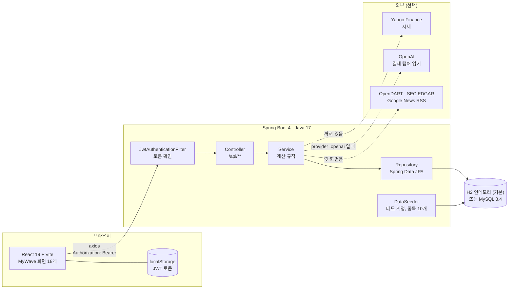
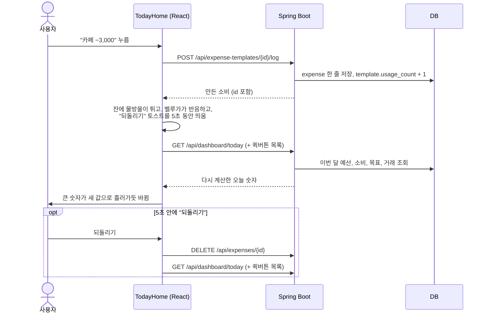

# 시스템 구조

브라우저의 React 앱 하나와 Spring Boot 서버 하나, DB 하나로 이루어집니다. 배포본은 없고 로컬에서만 돌립니다.



## 구성

| 층 | 기술 | 하는 일 |
|---|---|---|
| 화면 | React 19, TypeScript, Vite 8, Tailwind CSS 4, react-router 7 | 라우팅, 화면, 애니메이션 |
| 차트, 아이콘 | recharts 3, lucide-react | 소비 추이, 자산 비중, 아이콘 |
| 통신 | axios | 모든 요청에 토큰을 붙이고, 401이 오면 토큰을 지우고 로그인 화면으로 보냄 ([`axios.ts`](../frontend/src/api/axios.ts)) |
| 서버 | Spring Boot 4.0, Java 17, Lombok | REST API |
| 인증 | Spring Security + 직접 만든 JWT (HS256, 24시간) | 세션 없음. `/api/auth/**`만 열려 있음 |
| 저장 | Spring Data JPA, Hibernate | 기본은 H2 인메모리(서버를 끄면 사라짐), 프로파일을 바꾸면 MySQL |
| 시간 | `Clock` 빈 (`Asia/Seoul`) | "오늘"을 한 곳에서 정함. 테스트에서 날짜를 고정할 수 있음 |
| 빌드 | Gradle, npm | 백엔드 빌드 산출물은 OneDrive 동기화를 피해 OS 임시 폴더에 생김 |

외부 연동은 전부 선택입니다. 없어도 앱은 뜨고, MyWave 화면은 DB만으로 동작합니다.

- **Yahoo Finance 시세 갱신**은 `stockflow.data-refresh.enabled: false`가 기본이라 꺼져 있습니다. 켜면 1분마다 시드 종목 10개의 현재가를 갱신합니다.
- **OpenAI**는 결제 내역 캡처를 읽을 때만 부릅니다. 기본값 `stockflow.ai.provider: local`에서는 캡처 읽기 버튼이 막히고, 카드 문자 붙여넣기만 쓸 수 있습니다.
- **OpenDART, SEC EDGAR, Google News RSS**는 예전 모의투자 화면이 쓰던 연동입니다. 코드는 남아 있지만 MyWave 화면은 부르지 않습니다.

## 요청 하나가 지나가는 길

홈에서 "카페 −3,000" 퀵버튼을 눌렀을 때입니다.



화면이 숫자를 직접 빼지 않고 서버에 다시 묻는 것이 핵심입니다. 하루 예산을 계산하는 곳이 서버 한 곳뿐이라, 홈과 소비 화면과 코치가 서로 다른 숫자를 말할 일이 없습니다.

## 폴더

```text
backend/src/main/java/com/stockflow/
  auth, member              로그인, 회원, JWT
  dashboard                 홈(TodayService), 이번 달 요약
  expense                   소비, 퀵버튼, 문자/캡처 가져오기, 돈 흐름
  goal                      저축 목표, 추천 행동
  asset                     계좌, 월 예산, 자산 요약
  transaction, portfolio    투자 거래, 보유 종목, 평균단가
  notification, coach, search, company, watchlist
  global                    보안, CORS, Clock, 응답 형식, 예외 처리, 숫자 표기(Formats)
  seed                      데모 데이터 (DataSeeder)
  market, marketdata, stock, news, disclosure, earnings,
  research, theme, trade, memo, ai, upload
                            예전 모의투자 기능. MyWave 화면은 쓰지 않음

frontend/src/
  App.tsx, main.tsx         <MyWaveApp /> 하나를 그림
  auth/, api/               로그인 상태, axios
  pages/AuthPage.tsx        로그인, 회원가입
  mywave/
    MyWaveApp.tsx           라우트, 사이드바, 헤더, 하단 메뉴
    TodayHome.tsx           홈 (소다 잔, 퀵버튼, 이번 주 일곱 잔)
    Beluga.tsx              벨루가 캐릭터와 말풍선
    Celebration.tsx         목표 완료 축하 화면
    ExpenseCapture.tsx      퀵버튼 관리, 문자/캡처 가져오기, 돈 흐름
    runtime.tsx             여러 화면이 같이 쓰는 데이터 불러오기
    components.tsx          공용 카드, 차트
    myWaveApi.ts            API 호출 함수 전부
    screens/                목표, 소비, 투자, 리포트, 코치, 기업 상세, 계정 화면
```

## 실행 환경

| | 기본 (H2) | MySQL |
|---|---|---|
| 프로파일 | `SPRING_PROFILES_ACTIVE=default` | `mysql` (기본값은 `mysql,local`) |
| DB | 인메모리. 서버를 띄울 때마다 시드로 새로 채움 | `localhost:3306/stockflow`, 테이블은 `ddl-auto: update` |
| 백엔드 | `:8080` | `:8080` |
| 프론트 | `:5173` (Vite) | `:5173` |
| CORS 허용 | `localhost:5173`, `127.0.0.1:5173`, `localhost:3000` | 같음 |

`docker compose up`이면 MySQL, 백엔드, 프론트가 한 번에 뜹니다([`docker-compose.yml`](../docker-compose.yml)).
