# ERD

MyWave 화면이 실제로 읽고 쓰는 테이블 14개입니다. 예전 모의투자 기능의 테이블(주문 `trade_order`, 체결 `execution`, 거래장부 `trade_ledger`, 시세 `price_point`, 뉴스 `news`, 실적 `earnings`, 지수 `market_index`, 섹터 `sector_performance`, 투자 메모 `investment_memo`, AI 인사이트 `ai_insight`)는 아직 DB에 만들어지지만 지금 화면에서 쓰지 않아 뺐습니다.

컬럼과 타입은 JPA 엔티티를 읽어 적은 것이 아니라, H2로 서버를 띄웠을 때 Hibernate가 실제로 만든 DDL에서 옮겼습니다(2026-10-12).

```mermaid
erDiagram
    MEMBER ||--o{ FINANCIAL_ACCOUNT : "계좌를 등록한다"
    MEMBER ||--o{ MONTHLY_BUDGET : "달마다 예산을 정한다"
    MEMBER ||--o{ EXPENSE : "소비를 기록한다"
    MEMBER ||--o{ EXPENSE_TEMPLATE : "퀵버튼을 만든다"
    MEMBER ||--o{ SAVING_GOAL : "목표를 세운다"
    MEMBER ||--o| PORTFOLIO : "포트폴리오 하나"
    MEMBER ||--o{ INVESTMENT_TRANSACTION : "투자 거래를 기록한다"
    MEMBER ||--o{ MYWAVE_NOTIFICATION : "알림을 받는다"
    MEMBER ||--o{ FINANCIAL_COACH_MESSAGE : "코치와 대화한다"
    MEMBER ||--o{ PORTFOLIO_RISK_ACTION : "리스크 조정을 고른다"
    MEMBER ||--o{ WATCHLIST : "관심 종목"
    PORTFOLIO ||--o{ HOLDING : "보유 종목"
    STOCK ||--o{ HOLDING : ""
    STOCK ||--o{ INVESTMENT_TRANSACTION : ""
    STOCK ||--o{ WATCHLIST : ""

    MEMBER {
        bigint id PK
        varchar name
        varchar email UK
        varchar password_hash "BCrypt"
        varchar profile_image_url
        varchar membership_grade "BASIC | VIP"
        timestamp created_at
    }
    FINANCIAL_ACCOUNT {
        bigint id PK
        bigint member_id FK
        varchar name
        varchar account_type
        varchar institution_name
        decimal balance
        boolean included_in_assets "총자산에 넣을지"
        timestamp created_at
        timestamp updated_at
    }
    MONTHLY_BUDGET {
        bigint id PK
        bigint member_id FK
        varbinary budget_month "YearMonth, 아래 주의 참고"
        decimal income_amount
        decimal living_budget_amount "하루 예산의 재료"
        decimal fixed_expense_amount
        decimal planned_saving_amount
        decimal planned_investment_amount "투자 가능 금액의 재료"
    }
    EXPENSE {
        bigint id PK
        bigint member_id FK
        varchar category
        varchar merchant
        decimal amount
        date spent_date
        text memo
        timestamp created_at
        timestamp updated_at
    }
    EXPENSE_TEMPLATE {
        bigint id PK
        bigint member_id FK
        varchar name "버튼에 뜨는 이름"
        varchar category
        varchar merchant
        decimal amount
        int usage_count "많이 누른 순으로 홈에 3개"
        timestamp last_used_at
        timestamp created_at
        timestamp updated_at
    }
    SAVING_GOAL {
        bigint id PK
        bigint member_id FK
        varchar title
        decimal target_amount
        decimal current_amount
        date target_date
        varchar status "ACTIVE | PAUSED | COMPLETED"
        int priority
        timestamp created_at
        timestamp updated_at
    }
    PORTFOLIO {
        bigint id PK
        bigint member_id FK
        decimal total_asset
        decimal cash
        decimal total_purchase_amount
        decimal total_evaluation_amount
        decimal total_profit_loss
        decimal total_return_rate
        decimal daily_profit_loss
        decimal daily_return_rate
    }
    HOLDING {
        bigint id PK
        bigint portfolio_id FK
        bigint stock_id FK
        int quantity
        decimal average_price "이동평균"
        decimal current_price
        decimal evaluation_amount
        decimal profit_loss
        decimal return_rate
        decimal weight "투자 자산 중 비중"
    }
    INVESTMENT_TRANSACTION {
        bigint id PK
        bigint member_id FK
        bigint stock_id FK
        varchar symbol
        varchar stock_name
        enum transaction_type "BUY | SELL | DIVIDEND | DEPOSIT | WITHDRAWAL"
        int quantity
        decimal price
        decimal fee
        decimal tax
        decimal total_amount
        decimal realized_profit_loss
        date transaction_date
        text memo
        text reason
        varchar tags
        timestamp created_at
        timestamp updated_at
    }
    STOCK {
        bigint id PK
        varchar symbol UK
        varchar name
        varchar market
        decimal current_price
        decimal change_rate
        varchar sector
        decimal per
        decimal pbr
        decimal market_cap
    }
    WATCHLIST {
        bigint id PK
        bigint member_id FK
        bigint stock_id FK
        varchar reason
        varchar check_points
        varchar price_memo
        timestamp created_at
        timestamp updated_at
    }
    MYWAVE_NOTIFICATION {
        bigint id PK
        bigint member_id FK
        varchar category "목표 | 소비 | 투자 | AI 코치 | 이벤트"
        varchar title
        varchar body
        varchar target_path "누르면 이동할 화면"
        varchar tone "green | blue | violet ..."
        boolean is_read
        timestamp read_at
        timestamp created_at
    }
    FINANCIAL_COACH_MESSAGE {
        bigint id PK
        bigint member_id FK
        varchar role "USER | ASSISTANT"
        text content
        timestamp created_at
    }
    PORTFOLIO_RISK_ACTION {
        bigint id PK
        bigint member_id FK
        varchar action
        varchar status "SELECTED"
        timestamp created_at
    }
```

## 읽기 전에 알아 둘 것

- **FK 제약은 DB에 없습니다.** 엔티티가 `@ManyToOne` 대신 `memberId`, `stockId` 같은 숫자 컬럼을 들고 있어서, 위 그림의 관계는 코드가 지키는 논리적 관계입니다. 남의 기록을 고치지 못하게 막는 것도 DB가 아니라 서비스입니다. 서비스마다 `findOwned...()`로 `member_id`가 지금 로그인한 회원과 같은지 확인합니다.
- **금액은 전부 `numeric(38,2)`** (`BigDecimal`)입니다. 화면에 내보낼 때는 원 단위로 반올림합니다.
- **하루 예산, 남은 생활비, 투자 가능 금액은 저장하지 않습니다.** 요청마다 `monthly_budget`과 `expense`, `investment_transaction`에서 다시 계산합니다. 계산식은 [RULES.md](RULES.md)에 있습니다.
- **`holding`과 `portfolio`의 숫자는 거래 기록에서 다시 만들어집니다.** 거래를 등록, 수정, 삭제할 때마다 보유를 전부 지우고 `investment_transaction`을 날짜순으로 다시 재생합니다. 그래서 이 두 테이블은 원본이 아니라 계산 결과를 담아 두는 캐시에 가깝습니다.
- **`stock`은 회원과 무관한 공용 테이블입니다.** 시드로 10종목이 들어가고, 시세는 Yahoo Finance로 갱신합니다.

## 주의: 아직 고치지 않은 점

- `monthly_budget.budget_month`가 `varbinary(255)`입니다. `YearMonth`에 변환기(`AttributeConverter`)를 달지 않아서 Hibernate가 자바 객체를 직렬화해 넣고 있습니다. 앱에서는 동작하지만 DB에서 `WHERE budget_month = '2026-10'`처럼 읽을 수 없습니다. `char(7)`로 저장하는 변환기를 다는 것이 맞습니다.
- `monthly_budget`의 `(member_id, budget_month)`, `holding`의 `(portfolio_id, stock_id)`는 코드에서는 하나만 있다고 가정하는데 유니크 제약이 없습니다.
- 자주 쓰는 조회 조건인 `expense(member_id, spent_date)`에 인덱스가 없습니다. 지금 데이터 크기에서는 문제가 없습니다.

## 테이블 한 줄 설명

| 테이블 | 무엇을 담나 | 누가 만드나 |
|---|---|---|
| `member` | 회원. 이메일이 로그인 아이디 | 회원가입 |
| `financial_account` | 직접 적어 넣는 은행, 증권 계좌와 잔액. 은행과 연결하지 않음 | 자산 화면 |
| `monthly_budget` | 달마다 정하는 수입, 생활비, 고정비, 저축, 투자 계획 | 자산 화면의 월 예산 |
| `expense` | 소비 한 건 | 직접 입력, 퀵버튼, 카드 문자 붙여넣기, 결제 캡처 |
| `expense_template` | 홈과 소비 화면의 "눌러서 바로 기록" 버튼 | 소비 화면 |
| `saving_goal` | 저축 목표. 남은 날수가 가장 적은 진행 중 목표가 "메인 목표" | 목표 화면 |
| `portfolio` | 회원당 하나. 투자 자산 합계와 수익률 | 거래 기록에서 다시 계산 |
| `holding` | 종목별 보유 수량, 평균단가, 평가금액 | 거래 기록에서 다시 계산 |
| `investment_transaction` | 매수, 매도, 배당, 입출금 기록. 투자 숫자의 원본 | 투자 상세 화면 |
| `stock` | 종목 기본 정보와 현재가 (공용) | 시드 + 시세 갱신 |
| `watchlist` | 관심 종목 | 기업 상세 화면 |
| `mywave_notification` | 알림. 데모 계정에만 시드로 3개, 새 계정은 0개 | 시드 |
| `financial_coach_message` | AI 코치 대화 기록 | 코치 화면 |
| `portfolio_risk_action` | 리스크 화면에서 고른 조정 행동 | 리스크 화면 |
