# 화면 목록

로그인 화면과 로그인 뒤 화면 18개입니다. 캡처는 데모 계정으로 2026-10-12에 찍었습니다(데스크톱 1440×900, 모바일 390×844). 데스크톱과 모바일은 같은 주소에서 레이아웃만 바뀝니다.

**모든 화면이 같이 부르는 것.** 로그인 뒤 화면 틀(`Shell`)이 뜰 때 [`useMyWaveRuntimeData`](../frontend/src/mywave/runtime.tsx)가 아래 여섯 개를 한 번에 불러 모든 화면에 나눠 줍니다. 아래 표의 "API"에는 이것을 빼고 그 화면이 따로 부르는 것만 적었습니다.

`GET /api/dashboard/mywave` · `GET /api/goals` · `GET /api/goals/actions` · `GET /api/ai/financial-coach/messages` · `GET /api/holdings` · `GET /api/expenses`

이 중 대시보드 요청이 실패하면 화면 위에 "서버에서 숫자를 불러오지 못했어요" 띠와 "다시 불러오기" 버튼이 뜹니다. 나머지 다섯 개는 실패하면 그 부분만 비워 둡니다. 어느 경우에도 예시 숫자로 대신 채우지 않습니다.

## 한눈에

| 화면 | 주소 | 하는 일 | 따로 부르는 API |
|---|---|---|---|
| 로그인 | `/login`, `/register` | 로그인, 회원가입, 데모 계정으로 바로 들어가기 | `POST /api/auth/login`, `POST /api/auth/register` |
| **홈** | `/` | 오늘 더 써도 되는 돈, 하루 예산 잔, 퀵버튼, 이번 주 일곱 잔, 오늘 기록, 목표, 투자 요약 | `GET /api/dashboard/today`, `GET /api/expense-templates`, `POST /api/expense-templates/{id}/log`, `DELETE /api/expenses/{id}` |
| 목표 | `/goals` | 메인 목표, 추천 행동, 다른 목표들, 목표 수정과 삭제 | `PATCH /api/goals/{id}`, `DELETE /api/goals/{id}` |
| 목표 만들기 | `/goals/new` (`?id=`면 수정) | 목표 만들기, 고치기 | `POST /api/goals`, `PATCH /api/goals/{id}` |
| 소비 | `/spending` | 이번 달 합계, 지난달 같은 기간과 비교, 카테고리, TOP 3, 추이, 퀵버튼, 문자/캡처 가져오기, 돈 흐름, 절약 시뮬레이션 | 퀵버튼 4개, `/api/expenses/parse-sms`, `parse-image`, `import-status`, `bulk`, `cash-flow`, `saving-simulation` |
| 소비 상세 | `/spending/detail` | 소비 기록 목록, 추가, 수정, 삭제. 가게 이름 자동완성 | `GET /api/expenses/monthly-summary`, `POST`·`PATCH`·`DELETE /api/expenses`, `GET /api/expenses/merchants/suggest` |
| 절약 시뮬레이션 | `/spending/simulation` | TOP 3 카테고리를 줄이면 목표 달성률이 어떻게 되는지 | `POST /api/expenses/saving-simulation` |
| 투자 | `/portfolio` | 총 투자자산, 수익률, 자산 비중, 보유 종목, 거래 기록 | `GET /api/portfolio`, `GET`·`POST`·`PATCH`·`DELETE /api/transactions` |
| 투자 상세 | `/portfolio/detail` | 보유 종목 표와 거래 기록 관리 | 위와 같음 |
| 자산 비중 | `/portfolio/allocation` | 종목, 자산군별 비중 | |
| 리스크 | `/portfolio/risk` | 보유 비중으로 계산한 집중도, 조정 행동 고르기 | `POST /api/portfolio/risk-actions` |
| 기업 상세 | `/company/:symbol` | 시세, 재무 지표, 관심 종목 추가 | `GET /api/companies/{symbol}/analysis`, `POST`·`DELETE /api/watchlist/{symbol}` |
| 리포트 | `/reports` | 이번 달 돈 리포트, 6개월 소비와 예산, 보유 종목 바로가기 | |
| AI 코치 | `/coach` | 이번 달 상태 요약, 목표 전망, 대화 | `POST /api/ai/financial-coach/chat` |
| 자산 | `/assets` | 총자산, 계좌 등록과 수정, 월 예산 | `GET /api/assets/summary`, `/api/assets/accounts` 4개, `POST /api/assets/budgets/monthly` |
| 알림 | `/notifications` | 알림 목록, 분류 필터, 읽음, 삭제 | `/api/notifications` 5개 |
| 프로필 | `/profile` | 내 정보, 멤버십, 계좌 수, 비밀번호 변경, 로그아웃 | `GET /api/members/me`, `PATCH .../profile`, `PATCH .../membership`, `POST .../password`, `GET /api/assets/accounts`, `POST /api/auth/logout` |
| 시작하기 | `/onboarding` | 처음 쓰는 사람을 위한 안내 3장 | |
| 검색 | `/search?q=` | 목표, 소비, 보유 종목, 종목 검색 | `GET /api/search` |

예전 주소(`/transactions`, `/ai-report`, `/market`, `/stock/:symbol` 등 9개)는 지우지 않고 가장 가까운 새 화면으로 넘깁니다. 예전에 저장해 둔 링크가 깨지지 않게 하기 위해서입니다.

---

## 홈

| 데스크톱 | 모바일 |
|---|---|
|  |  |

앱을 열면 가장 먼저 보는 화면이고, 하루에 여러 번 여는 화면입니다. 그래서 숫자 하나만 크게 둡니다. **오늘 더 써도 되는 돈**입니다([계산식](RULES.md#1-오늘-더-써도-되는-돈)).

- **하루 예산 한 잔.** 오늘 예산을 잔 하나로 그립니다. 쓸수록 물이 줄고, 예산을 넘기는 순간 잔이 흔들립니다.
- **눌러서 바로 기록.** 많이 쓴 퀵버튼 3개입니다. 누르면 바로 저장되고, 잔에 물방울이 튀고, 벨루가가 반응하고, 5초 동안 "되돌리기"가 뜹니다.
- **이번 주 일곱 잔.** 월요일부터 일요일까지 날마다 쓴 돈을 작은 잔으로 그립니다. 누르면 그날 금액이 나옵니다.
- **벨루가.** 오늘 상황에 따라 표정과 말이 바뀝니다. 말풍선에는 숫자를 넣지 않고, 예산을 넘겼을 때는 귀엽게 굴지 않고, 투자 조언은 하지 않습니다.

## 목표

| 목표 | 목표 만들기 |
|---|---|
|  | 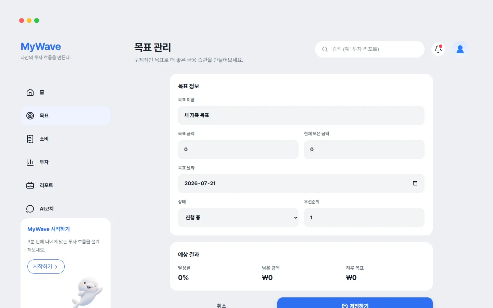 |

메인 목표(진행 중인 것 중 목표일이 가장 가까운 것)를 크게 보여 주고, 하루에 얼마씩 모으면 되는지 알려 줍니다. 아래 추천 행동은 이번 달 실제로 많이 쓴 카테고리 세 곳을 20% 줄였을 때 아끼는 돈입니다. 목표를 완료로 바꾸면 축하 화면이 한 번 뜹니다.

## 소비

| 소비 | 소비 상세 |
|---|---|
|  | 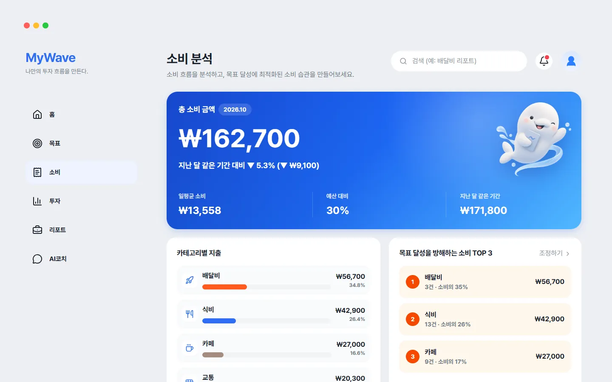 |
| 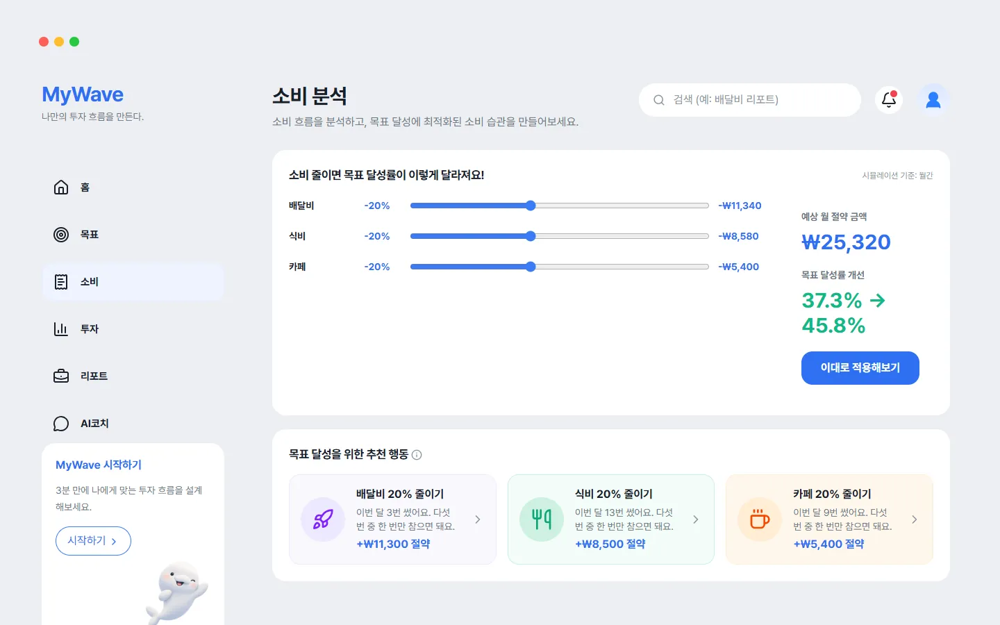 | |

비교는 지난달 한 달 전체가 아니라 **지난달 같은 날짜까지**와 합니다. 기록하는 길은 네 가지입니다. 직접 입력, 퀵버튼, 카드 결제 문자 붙여넣기, 결제 내역 캡처(OpenAI를 켰을 때만)입니다. 문자와 캡처는 바로 저장하지 않고 후보 목록을 먼저 보여 준 뒤, 확인한 것만 한꺼번에 저장합니다.

## 투자

| 투자 | 투자 상세 |
|---|---|
| 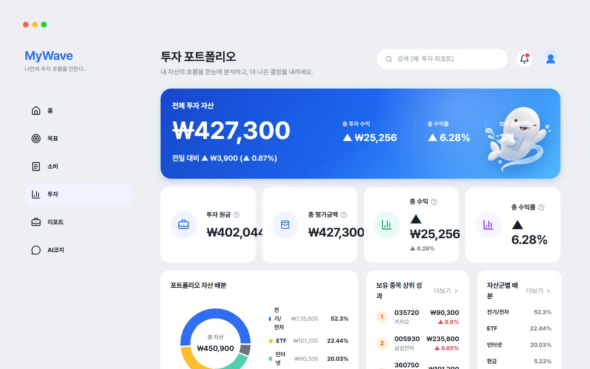 |  |
| 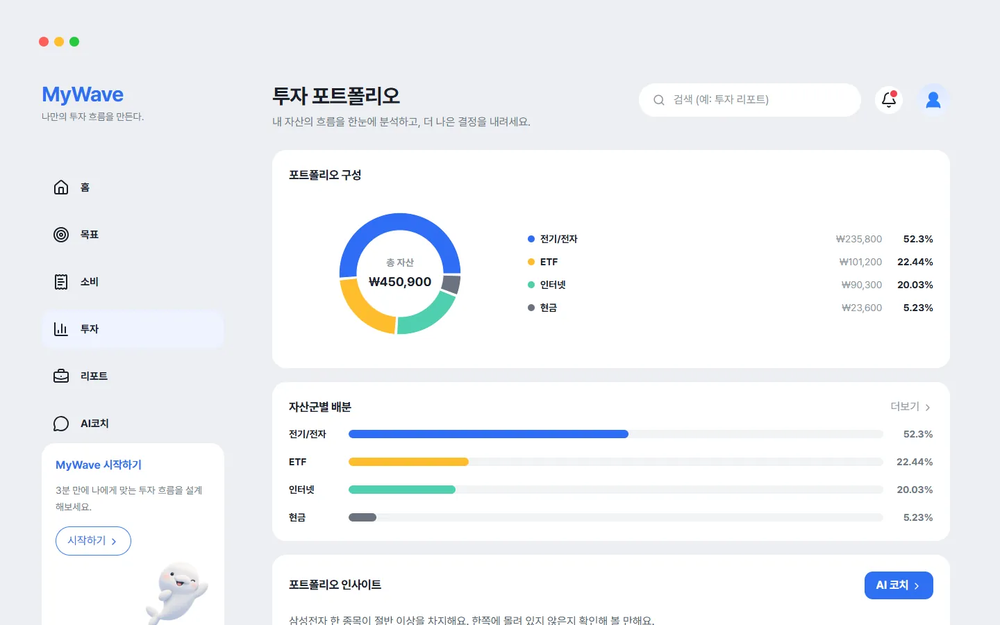 | 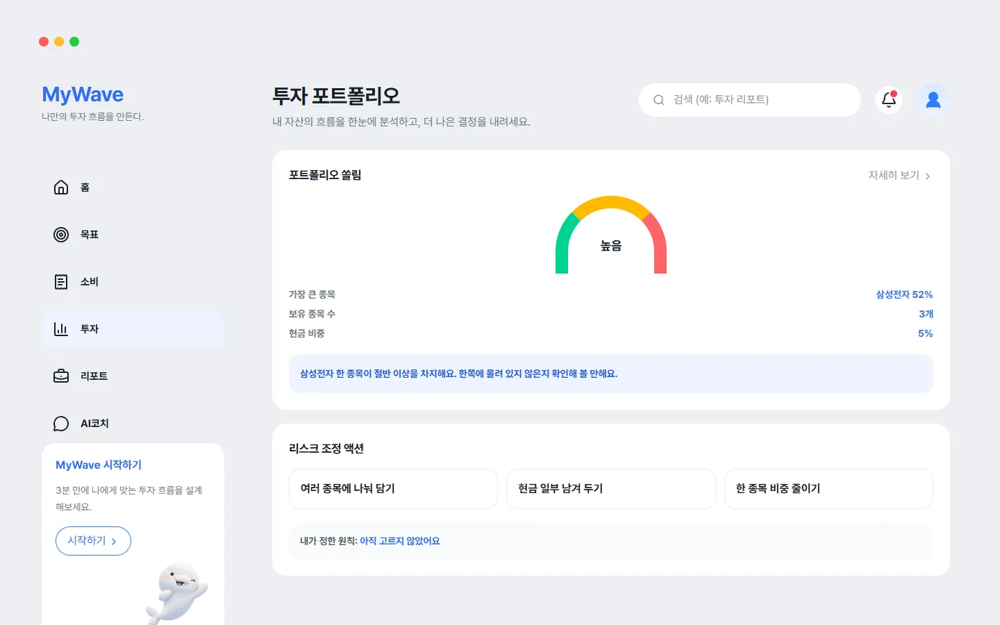 |

투자 숫자의 원본은 거래 기록 하나입니다. 거래를 넣거나 고치거나 지우면 보유 종목과 평균단가를 처음부터 다시 계산합니다. 리스크 화면의 집중도도 고정 문구가 아니라 실제 보유 비중으로 계산합니다.

## 기업 상세 · 리포트 · AI 코치

| 기업 상세 | 리포트 |
|---|---|
| 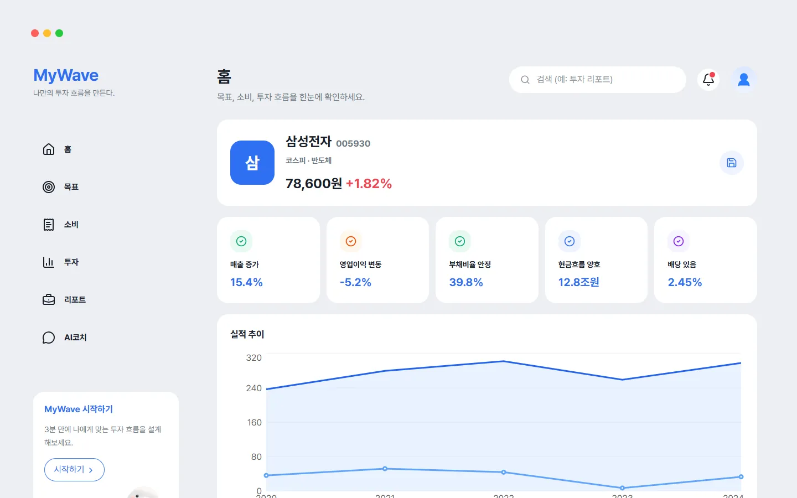 | 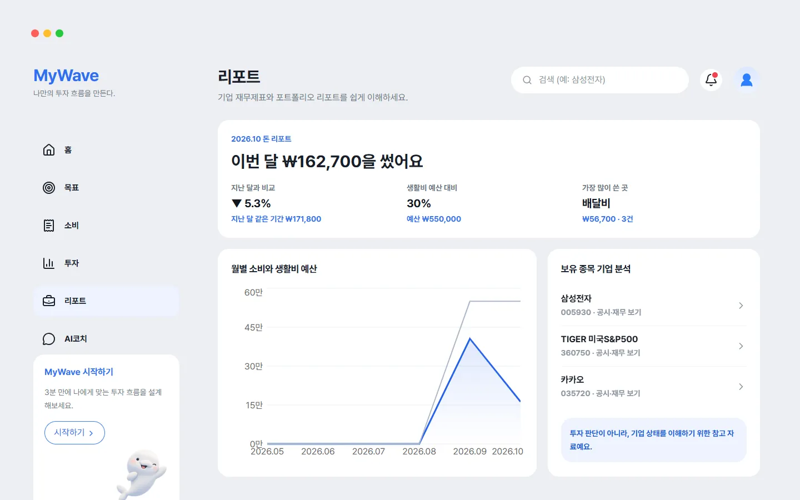 |
|  | |

코치의 답은 언어 모델이 아니라 규칙이 만듭니다. 질문에 "투자", "소비", "목표"가 들어 있는지 보고 이번 달 숫자로 문장을 만듭니다. 종목을 추천하지 않기 위해 이렇게 두었습니다.

## 계정

| 자산 | 알림 |
|---|---|
| 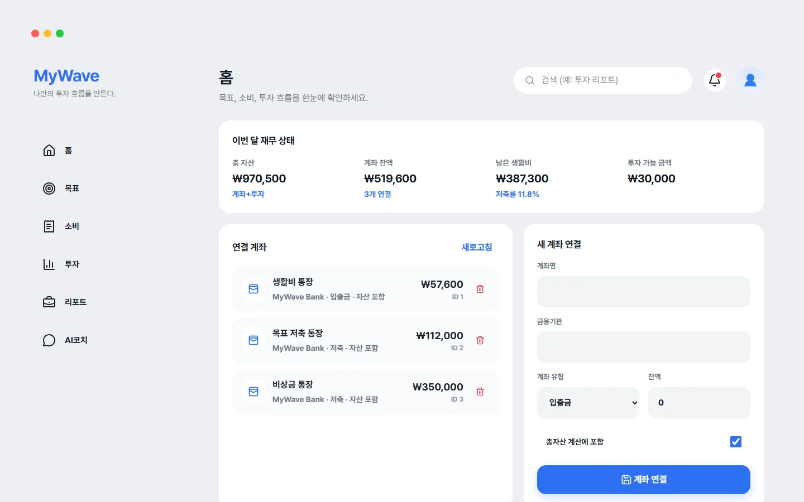 | 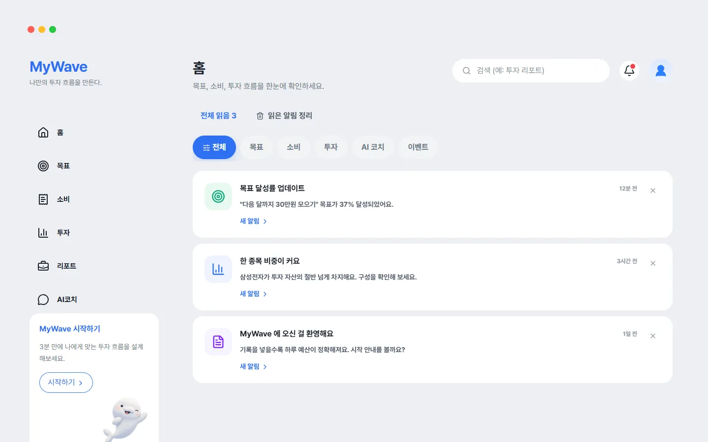 |
| 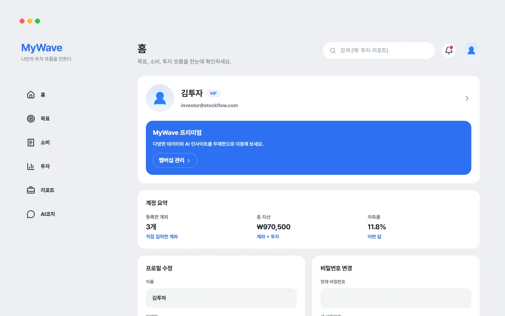 | 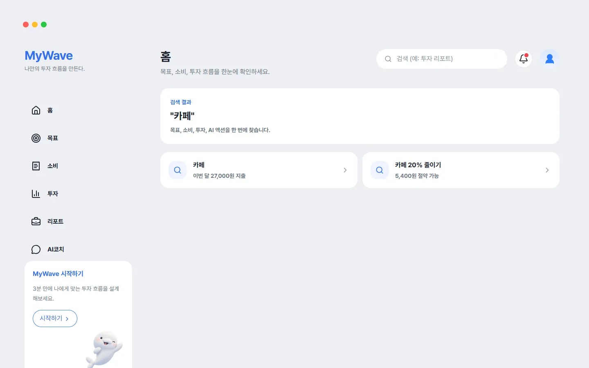 |
| 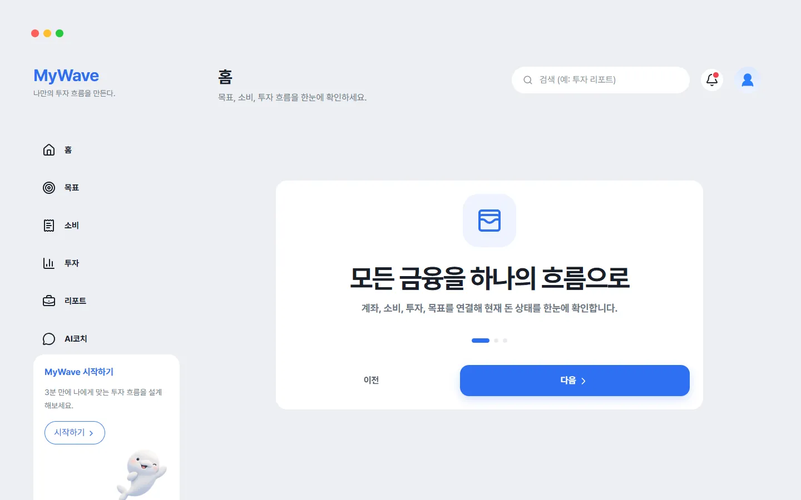 | 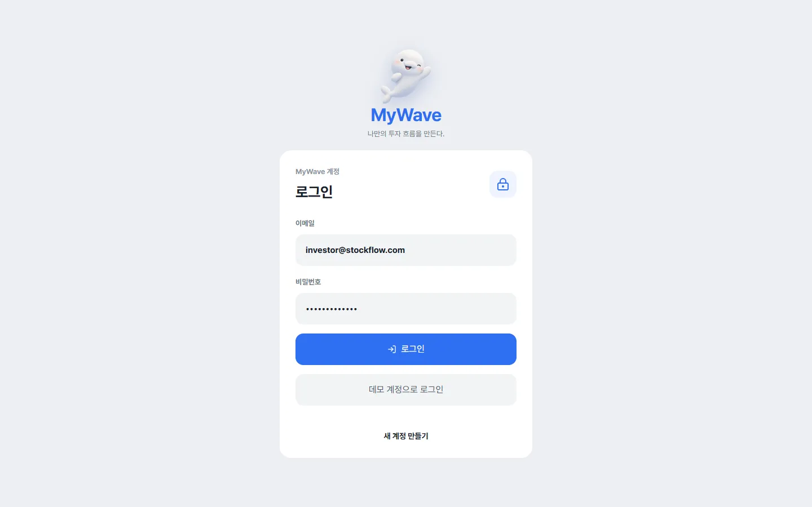 |

계좌는 은행과 연결하지 않고 직접 적어 넣습니다. 알림은 데모 계정에만 시드로 3개가 있고, 새 계정은 0개로 시작합니다.

---

## 캡처하면서 발견한 것

- **헤더 제목이 "홈"으로 뜨는 화면이 여섯 개입니다.** 자산, 알림, 프로필, 검색, 기업 상세, 시작하기 화면입니다. 헤더 제목을 정하는 [`pageMeta()`](../frontend/src/mywave/MyWaveApp.tsx)가 목표, 소비, 투자, 리포트, 코치 다섯 경로만 알고, 나머지는 전부 "홈"으로 떨어집니다.
- **로그인 화면만 옛 이름 "StockFlow"입니다.** 로그인 뒤 화면은 전부 MyWave인데, 재사용한 `AuthPage`의 로고와 문구는 그대로입니다.
- **결제 캡처 안내의 벨루가 말풍선에 숫자가 들어갑니다.** "오늘 N장 남았고"라는 문장인데, 말풍선에는 숫자를 넣지 않는다는 규칙과 어긋납니다(OpenAI를 켰을 때만 보입니다).
